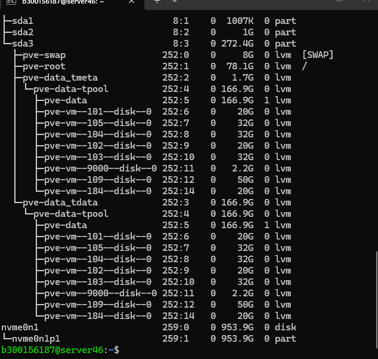
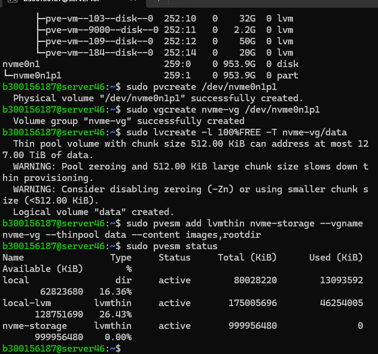
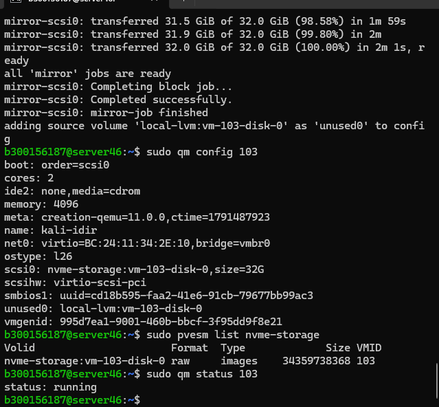

# 💾 Labo 5 — Introduction au stockage sous Linux et Proxmox VE

**👨‍🎓 Étudiant :** Idir Islam Chili
**🆔 Numéro étudiant :** 300156187
**📚 Cours :** INF1085 — Administration Linux
**🖥️ Serveur :** server46 (S13 — 10.7.236.199)
**💻 VM utilisée :** 103 — kali-idir (2 cœurs, 4096 Mo de RAM, disque 32 Go)
**📅 Date :** 12 novembre 2026

---

## 🎯 1. Objectif du labo

À la fin de ce labo, je devais être capable de :

- ✅ Comprendre les différents types de stockage
- ✅ Identifier les disques présents dans un système Linux
- ✅ Comprendre les concepts de partition, système de fichiers et LVM
- ✅ Comprendre les stockages utilisés par Proxmox VE
- ✅ Ajouter un disque NVMe comme stockage pour les machines virtuelles
- ✅ Déplacer le disque d'une machine virtuelle vers le stockage NVMe

👥 Le labo s'est fait en groupe sur le même serveur (server46). On a décidé ensemble que c'est moi qui créais le stockage NVMe, pour éviter que plusieurs personnes fassent les mêmes étapes sur le même disque. Ensuite, chaque membre du groupe déplace sa propre VM.

---

## 📖 2. Théorie : les types de stockage

### 💽 2.1 Disque dur (HDD)

Le HDD utilise des plateaux magnétiques et une tête de lecture. Il a une grande capacité pour un faible coût, mais il est plus lent que les autres types de disques. On le trouve surtout pour le stockage de masse, comme les sauvegardes.

### ⚡ 2.2 SSD SATA

Le SSD SATA n'a pas de pièces mécaniques, donc il est plus rapide qu'un HDD et plus résistant aux chocs. Il utilise l'interface SATA, ce qui limite quand même sa vitesse.

### 🚀 2.3 SSD NVMe

Le NVMe utilise le bus PCI Express, donc il est beaucoup plus rapide qu'un SSD SATA. C'est le meilleur choix pour les machines virtuelles dans Proxmox, parce que les VM font beaucoup de lectures et d'écritures disque. Sur notre serveur, le NVMe fait 953,9 Go.

| Type | ⚡ Vitesse | 💰 Coût | 🎯 Usage |
|------|-----------|---------|----------|
| HDD | 🐢 Lente | 💲 Faible | Sauvegardes, gros volumes |
| SSD SATA | 🚶 Moyenne | 💲💲 Moyen | Système, usage général |
| SSD NVMe | 🚀 Très rapide | 💲💲💲 Plus élevé | Machines virtuelles |

---

## 🧱 3. Théorie : partition, système de fichiers et LVM

### 🧩 3.1 La partition

Un disque peut être divisé en plusieurs partitions. Une partition, c'est une partie du disque qu'on peut utiliser séparément. Dans ce labo, j'ai créé une seule partition qui prend tout le NVMe : `nvme0n1p1`.

Avant de créer une partition, il faut une table de partition. J'ai utilisé GPT, qui est le format moderne et qui supporte les gros disques, au lieu de MBR qui est l'ancien format.

### 🗂️ 3.2 Le système de fichiers

Un système de fichiers organise les données sur une partition (par exemple `ext4`, `xfs`, `ntfs`, `fat32`). Dans ce labo, on n'a pas créé de système de fichiers sur le NVMe, parce qu'on l'utilise directement avec LVM, pas comme un dossier monté.

On peut voir le type d'un système de fichiers avec la commande `blkid`.

### 📦 3.3 LVM (Logical Volume Manager)

LVM permet de gérer l'espace disque de façon dynamique. Il fonctionne en trois couches :

```
Disque / Partition
       │
       ▼
  PV (Physical Volume)
       │
       ▼
  VG (Volume Group)
       │
       ▼
  LV (Logical Volume)
```

- **🧱 PV (Physical Volume)** : c'est un disque ou une partition qu'on donne à LVM. Dans mon cas, c'est `/dev/nvme0n1p1`.
- **📦 VG (Volume Group)** : c'est un groupe qui regroupe un ou plusieurs PV. J'ai créé le groupe `nvme-vg`.
- **📁 LV (Logical Volume)** : c'est un volume logique créé dans un VG, qu'on utilise comme espace de stockage. Dans mon cas, c'est le Thin Pool `data`.

### 🚀 3.4 LVM-Thin (Thin Provisioning)

Proxmox utilise souvent LVM-Thin pour les disques de VM. Avec le thin provisioning, l'espace disque n'est vraiment consommé que quand la VM écrit des données, pas d'avance. Ça permet de mettre plus de VM sur le même disque sans gaspiller de l'espace.

```
NVMe
  │
  ▼
 PV
  │
  ▼
 VG (nvme-vg)
  │
  ▼
 Thin Pool (data)
  │
  ▼
 💻 Disques des VM
```

---

## 🗄️ 4. Les stockages Proxmox

On peut voir les stockages configurés dans Proxmox avec :

```
sudo pvesm status
```

Sur notre serveur, il y a trois stockages :

| Stockage | Type | 📂 Contenu |
|----------|------|-----------|
| `local` | Directory | ISO, sauvegardes, templates |
| `local-lvm` | LVM-Thin | Disques des VM, conteneurs LXC |
| `nvme-storage` | LVM-Thin | Disques des VM (créé dans ce labo) |

- **📁 `local`** : c'est un dossier normal sur le disque système. Il contient les images ISO, les sauvegardes et les templates.
- **💾 `local-lvm`** : c'est le stockage par défaut pour les disques de VM, créé sur le disque `sda` pendant l'installation de Proxmox.
- **🚀 `nvme-storage`** : c'est le nouveau stockage que j'ai créé dans ce labo, sur le disque NVMe. Il sert aussi pour les disques de VM, mais il est beaucoup plus rapide que `local-lvm`.

---

## 🔧 5. Partie pratique : créer le stockage NVMe

### 🔌 5.1 Connexion au serveur

Je me suis connecté au serveur en SSH avec mon sous-utilisateur :

```
ssh b300156187@10.7.236.199
```

Comme je ne suis pas `root`, j'ai mis `sudo` devant les commandes qui modifient le système.

### 🔍 5.2 Voir les disques

```
lsblk
```

Résultat : on voit le disque système `sda` (273,4 Go) avec les volumes Proxmox (`pve-root`, `pve-data`, les disques des VM 101, 102, 103, 104, 105, 109, 184), et le NVMe `nvme0n1` (953,9 Go) sans aucune partition.



⚠️ C'est important de vérifier ça avant de commencer, pour être sûr de ne pas toucher au mauvais disque. Le NVMe est vide, donc on peut le partitionner sans rien écraser.

### 🧩 5.3 Créer la partition

J'ai ouvert le disque avec `fdisk` :

```
sudo fdisk /dev/nvme0n1
```

`fdisk` a dit que le disque n'avait pas de table de partition reconnue, et il a créé une table DOS (MBR) par défaut. Je l'ai remplacée par une table GPT, puis j'ai créé la partition :

- ⌨️ `g` — créer une nouvelle table GPT
  - ✅ Résultat : `Created a new GPT disklabel`
- ⌨️ `n` — créer une nouvelle partition
  - Numéro de partition : Entrée (défaut : 1)
  - Premier secteur : Entrée (défaut : 2048)
  - Dernier secteur : Entrée (défaut : 2000408575, fin du disque)
  - ✅ Résultat : `Created a new partition 1 of type 'Linux filesystem' and of size 953.9 GiB.`
- ⌨️ `w` — écrire la table de partition sur le disque
  - ✅ Résultat : `The partition table has been altered. Syncing disks.`

J'ai vérifié avec `lsblk` : la partition `nvme0n1p1` est bien là, avec 953,9 Go. 🎉

### 🧱 5.4 Créer le Physical Volume (PV)

```
sudo pvcreate /dev/nvme0n1p1
```

✅ Résultat :

```
Physical volume "/dev/nvme0n1p1" successfully created.
```

### 📦 5.5 Créer le Volume Group (VG)

```
sudo vgcreate nvme-vg /dev/nvme0n1p1
```

✅ Résultat :

```
Volume group "nvme-vg" successfully created
```

### 🚀 5.6 Créer le Thin Pool

```
sudo lvcreate -l 100%FREE -T nvme-vg/data
```

✅ Résultat :

```
Logical volume "data" created.
```

⚠️ Il y a eu deux avertissements (WARNING) sur le « zeroing » et la taille des chunks de 512 KiB. Ce sont juste des avertissements de performance, pas des erreurs — la commande a quand même réussi.

L'option `-l 100%FREE` veut dire qu'on utilise 100 % de l'espace libre du VG, et `-T` veut dire qu'on crée un thin pool, pas un volume normal.

### 🗄️ 5.7 Ajouter le stockage à Proxmox

```
sudo pvesm add lvmthin nvme-storage --vgname nvme-vg --thinpool data --content images,rootdir
```

La commande n'a affiché aucune erreur, elle est juste revenue au prompt, ce qui veut dire qu'elle a réussi. ✅

Vérification avec `sudo pvesm status` :

```
Name            Type     Status   Total (KiB)   Used (KiB)   Available (KiB)   %
local           dir      active   80028220      13093592     62823680          16,36%
local-lvm       lvmthin  active   175005696     46254005     128751690         26,43%
nvme-storage    lvmthin  active   999956480     0            999956480         0,00%
```

🎉 Le stockage `nvme-storage` est bien là, actif, avec environ 954 Go disponibles et 0 % utilisé.



---

## 🚀 6. Partie pratique : déplacer une VM vers le stockage NVMe

### 🔍 6.1 Identifier ma VM

```
sudo qm list
```

| VMID | NAME | STATUS | MEM (MB) | BOOTDISK (GB) |
|------|------|--------|----------|---------------|
| 100 | vm1 | stopped | 2048 | 0.00 |
| 101 | Mouna | stopped | 4096 | 0.00 |
| 102 | Rahma | running | 2048 | 20.00 |
| 103 | kali-idir | running | 4096 | 32.00 |
| 104 | VM 104 | stopped | 2048 | 0.00 |
| 105 | ubuntu-Alexia | running | 4000 | 32.00 |
| 109 | Garvey | running | 2096 | 50.00 |
| 184 | walid | running | 2048 | 20.00 |
| 9000 | ubuntu-jammy-template | stopped | 2048 | 0.00 |

💻 Ma VM est la **103, `kali-idir`**. C'est important de vérifier l'ID avant de déplacer, parce qu'on est plusieurs sur le même serveur et il ne faut pas toucher à la VM d'un autre. ⚠️

### 🔍 6.2 Vérifier le disque actuel (avant)

```
sudo qm config 103
```

La ligne importante :

```
scsi0: local-lvm:vm-103-disk-0,size=32G
```

Le disque est encore sur `local-lvm`, il fait 32 Go. La VM a 2 cœurs, 4096 Mo de RAM, et elle est en train de tourner (`running`).

### 🚀 6.3 Déplacer le disque

```
sudo qm move_disk 103 scsi0 nvme-storage
```

⏱️ La copie a pris environ 2 minutes :

```
mirror-scsi0: transferred 32.0 GiB of 32.0 GiB (100.00%) in 2m 1s, ready
all 'mirror' jobs are ready
mirror-scsi0: Completing block job...
mirror-scsi0: Completed successfully.
mirror-scsi0: mirror-job finished
adding source volume 'local-lvm:vm-103-disk-0' as 'unused0' to config
```

ℹ️ La dernière ligne veut dire que l'ancien disque n'a pas été supprimé, il est juste détaché et marqué comme `unused0` dans la config. C'est normal avec `qm move_disk` quand la VM tourne.

### ✅ 6.4 Vérifier le résultat (après)

```
sudo qm config 103
```

La ligne du disque a changé :

```
scsi0: nvme-storage:vm-103-disk-0,size=32G
unused0: local-lvm:vm-103-disk-0
```

🎉 Le disque est maintenant sur `nvme-storage`, avec la même taille (32 Go).

J'ai aussi vérifié avec :

```
sudo pvesm list nvme-storage
```

✅ Résultat :

```
VolID                              Format  Type    Size        VMID
nvme-storage:vm-103-disk-0         raw     images  34359738368 103
```

Le disque `vm-103-disk-0` apparaît bien dans le stockage NVMe.

### 🟢 6.5 Vérifier que la VM fonctionne toujours

```
sudo qm status 103
```

✅ Résultat :

```
status: running
```



💻 La VM tourne toujours normalement après le déplacement, elle n'a pas été arrêtée pendant la migration.

---

## 📊 7. Résumé avant / après

**⬅️ Avant :**

```
local-lvm
   │
   └── VM 103 (kali-idir, 32 Go)
```

**➡️ Après :**

```
nvme-storage
   │
   └── VM 103 (kali-idir, 32 Go)
```

| Étape | ✅ Résultat |
|-------|------------|
| Partition `nvme0n1p1` | Créée, 953,9 Go |
| PV `/dev/nvme0n1p1` | Créé |
| VG `nvme-vg` | Créé |
| Thin Pool `data` | Créé, 100 % de l'espace libre |
| Stockage `nvme-storage` | Ajouté à Proxmox, actif |
| Disque VM 103 | Déplacé de `local-lvm` vers `nvme-storage` |
| VM 103 | Toujours `running` après le déplacement |

---

## 🧠 8. Questions de réflexion

**1️⃣ Quelle est la différence entre un HDD, un SSD SATA et un NVMe ?**
Le HDD est mécanique, lent mais pas cher et avec une grande capacité. Le SSD SATA est plus rapide parce qu'il n'a pas de pièces mécaniques, mais il est limité par l'interface SATA. Le NVMe utilise PCI Express, donc il est beaucoup plus rapide que les deux autres, et c'est le meilleur pour les VM.

**2️⃣ Quel est le rôle d'une partition ?**
Une partition divise un disque en plusieurs parties qu'on peut utiliser séparément. Ça permet d'organiser l'espace disque, par exemple une partition pour le système et une autre pour les données.

**3️⃣ À quoi sert un système de fichiers ?**
Un système de fichiers organise les données sur une partition : il gère les fichiers, les dossiers, les permissions, etc. Sans système de fichiers, on ne pourrait pas stocker et retrouver des fichiers sur un disque.

**4️⃣ Que signifient les acronymes PV, VG et LV ?**
PV veut dire Physical Volume (volume physique, un disque ou une partition donné à LVM). VG veut dire Volume Group (groupe de volumes, qui regroupe un ou plusieurs PV). LV veut dire Logical Volume (volume logique, créé dans un VG et utilisé comme espace de stockage).

**5️⃣ Pourquoi Proxmox utilise-t-il souvent LVM-Thin ?**
Parce qu'avec le thin provisioning, l'espace n'est consommé que quand la VM écrit vraiment des données. Ça permet de mettre plus de VM sur le même disque sans gaspiller de l'espace, et les disques de VM sont plus faciles à gérer (snapshots, clones, etc.).

**6️⃣ Quelle commande permet d'afficher les stockages configurés dans Proxmox ?**
`pvesm status` (avec `sudo` si on n'est pas root).

**7️⃣ Quel est l'avantage d'utiliser un NVMe pour les machines virtuelles ?**
Le NVMe est beaucoup plus rapide qu'un HDD ou un SSD SATA, donc les VM démarrent plus vite, les applications répondent plus vite, et les opérations disque (copie, migration) prennent moins de temps. Dans ce labo, la copie de 32 Go a pris environ 2 minutes. 🚀

---

## ⚠️ 9. Difficultés rencontrées

- **👥 Serveur partagé :** on est plusieurs sur le même serveur, donc il a fallu se mettre d'accord pour qu'une seule personne crée le stockage NVMe. Si deux personnes avaient fait les mêmes commandes, ça aurait échoué ou écrasé le travail de l'autre.
- **🔑 Sous-utilisateur :** je me suis connecté avec mon sous-utilisateur `b300156187`, pas avec `root`, donc j'ai dû mettre `sudo` devant les commandes qui modifient le système (`fdisk`, `pvcreate`, `vgcreate`, `lvcreate`, `pvesm`).
- **⚠️ Avertissements du Thin Pool :** la commande `lvcreate` a affiché deux WARNING sur le zeroing et la taille des chunks. J'ai vérifié que ce n'étaient que des avertissements, pas des erreurs, et que le volume a bien été créé.
- **🗑️ Ancien disque en `unused0` :** après le déplacement, l'ancien disque est resté dans la config comme `unused0`. Il n'a pas été supprimé automatiquement. C'est normal, mais il faudra le supprimer manuellement plus tard si on veut libérer l'espace sur `local-lvm`.

---

## 🎉 10. Conclusion

Le labo est terminé. ✅ Le stockage NVMe est créé et fonctionne, et le disque de ma VM 103 est passé de `local-lvm` à `nvme-storage` sans arrêter la VM. La VM tourne toujours normalement après le déplacement. 🟢

Ce que j'ai appris : comment identifier un disque sous Linux, comment créer une partition GPT, comment fonctionne LVM (PV, VG, LV, Thin Pool), et comment ajouter un stockage à Proxmox et y déplacer une VM. C'est un travail d'équipe aussi, parce que le stockage est partagé par tout le groupe — maintenant que je l'ai créé, les autres peuvent migrer leur VM à leur tour. 👥🚀
