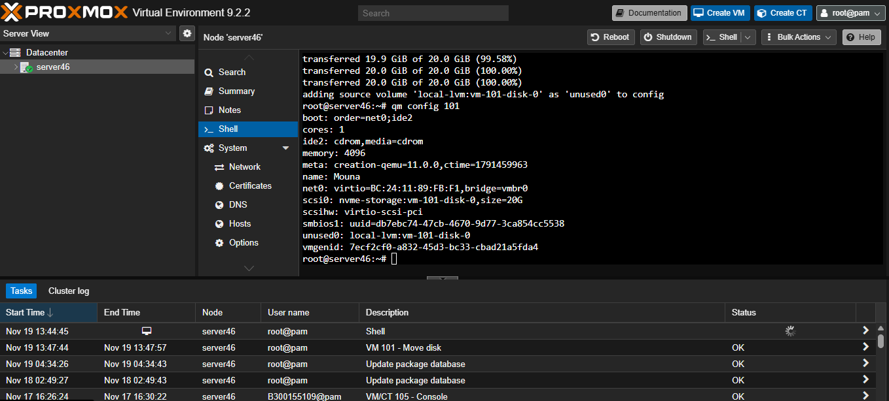
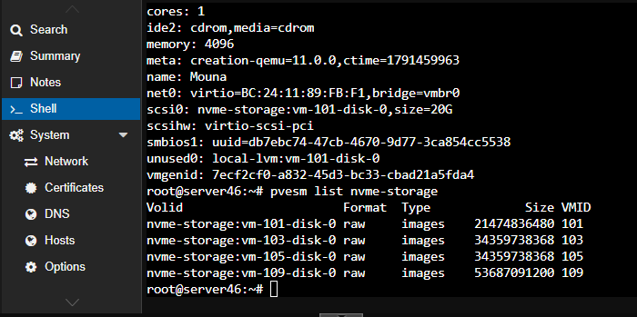
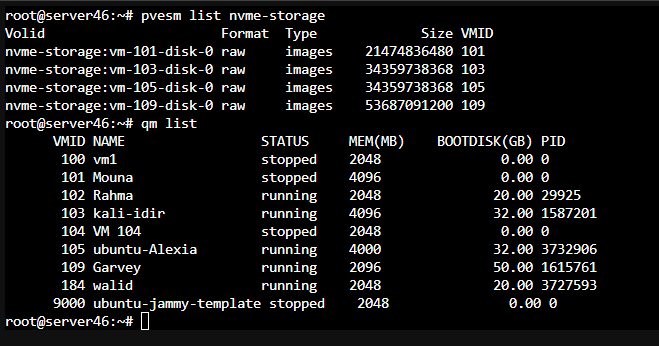

# 💾 Labo 5 - Introduction au stockage sous Linux et Proxmox VE
# 👩‍🎓 Informations

👩‍🎓 Étudiante : Mouna Kaci
 🆔 Numéro étudiant : 300156497
 📚 Cours : INF1085 - Administration Linux
 🖥️ Serveur : server46 (10.7.236.199)
 💻 Machine virtuelle : 101 - Mouna
 📅 Date : Novembre 2026

# 🎯 Objectif du laboratoire

À la fin de ce laboratoire, je devais être capable de :

✅ Comprendre les différents types de stockage

✅ Comprendre le rôle des partitions et des systèmes de fichiers

✅ Comprendre le fonctionnement de LVM

✅ Comprendre les stockages utilisés dans Proxmox VE

✅ Vérifier les stockages disponibles sur un serveur Linux

✅ Déplacer le disque d'une machine virtuelle vers un stockage NVMe

✅ Vérifier le bon fonctionnement de la machine virtuelle après la migration

# 📖 Introduction

Le stockage est un élément essentiel dans un système Linux et dans un environnement de virtualisation comme Proxmox VE. Il permet de conserver le système d'exploitation, les fichiers, les sauvegardes et les disques des machines virtuelles.

Dans ce laboratoire, j'ai étudié les différents types de stockage ainsi que l'organisation des données avec Linux. J'ai également appris comment Proxmox gère les stockages et comment déplacer une machine virtuelle vers un disque NVMe afin d'améliorer les performances.

# 💽 Les types de stockage
🐢 HDD (Disque dur)

Le HDD possède des pièces mécaniques qui tournent pour lire et écrire les données.

# Avantages

✅ Grande capacité

✅ Faible coût

Inconvénients

❌ Plus lent

❌ Pièces mécaniques susceptibles de s'user

⚡ SSD SATA

Le SSD SATA ne contient aucune pièce mécanique.

# Avantages

✅ Plus rapide qu'un HDD

✅ Plus silencieux

✅ Plus fiable

# Inconvénients

❌ Plus coûteux qu'un HDD

❌ Vitesse limitée par l'interface SATA

🚀 SSD NVMe

Le SSD NVMe utilise l'interface PCI Express et offre les meilleures performances.

# Avantages

✅ Très grande vitesse

✅ Temps d'accès très faible

✅ Excellent choix pour les machines virtuelles

🗄️ Les stockages Proxmox

Pour afficher les stockages disponibles :

Shell
pvesm status

Sur le serveur, j'ai observé les stockages suivants :

Stockage	Type	Utilisation
local	Directory	ISO, sauvegardes, templates
local-lvm	LVM-Thin	Disques des VM
nvme-storage	LVM-Thin	Disques des VM sur NVMe
🔍 Vérification de ma machine virtuelle

J'ai commencé par afficher les machines virtuelles :

Shell
qm list

Ma machine virtuelle est :

Plain Text
101 - Mouna

# 📸 Capture de la liste des VM

# 💾 Vérification du disque avant migration

Commande utilisée :

Shell
qm config 101

Résultat :

Plain Text
scsi0: local-lvm:vm-101-disk-0,size=20G

Le disque de ma VM était stocké sur local-lvm.

# 🚀 Migration vers le stockage NVMe

Pour déplacer le disque vers le stockage NVMe :

Shell
qm move_disk 101 scsi0 nvme-storage

La migration s'est terminée avec succès et le disque a été copié vers le stockage NVMe.

✅ Vérification après migration

Commande :

Shell
qm config 101

Résultat :

Plain Text
scsi0: nvme-storage:vm-101-disk-0,size=20G

Le disque de la machine virtuelle est maintenant hébergé dans nvme-storage.

📊 Résumé
Avant
Plain Text
local-lvm
│
└── VM 101
Après
Plain Text
nvme-storage
│
└── VM 101
Résultats obtenus

✅ Machine virtuelle identifiée

✅ Stockage vérifié

✅ Migration vers NVMe réalisée

✅ Configuration mise à jour

✅ Utilisation du stockage NVMe confirmée

# 🧠 Ce que j'ai appris

Au cours de ce laboratoire, j'ai appris :

Comment identifier les différents types de stockage.
Comment vérifier les stockages dans Linux et Proxmox.
Le rôle des partitions et de LVM.
Comment déplacer un disque de machine virtuelle.
Les avantages d'un stockage NVMe pour les performances.
# ⚠️ Difficultés rencontrées
Comprendre la structure des stockages Proxmox.
Identifier le bon disque à déplacer.
Vérifier que la migration s'est déroulée correctement.
Comprendre les différences entre local-lvm et nvme-storage.
# 🎉 Conclusion

Ce laboratoire m'a permis de mieux comprendre la gestion du stockage sous Linux et Proxmox VE. J'ai appris à identifier les différents types de stockage et à vérifier leur utilisation dans un environnement virtualisé.

La partie pratique consistait à déplacer le disque de ma machine virtuelle 101 - Mouna du stockage local-lvm vers nvme-storage. La migration a été réalisée avec succès et les vérifications ont confirmé que le disque utilise maintenant le stockage NVMe.

# ✅ Objectif atteint : utilisation du stockage NVMe pour améliorer les performances de la machine virtuelle. 🚀
