# 📊 Projet — Serveur de monitoring Linux

## 👨‍💻 Informations

| Information | Détail |
|---|---|
| Étudiant | Ouassim Ahmed Benamira |
| Numéro étudiant | 300150564 |
| Cours | INF1085 — Administration Linux |
| Projet | Monitoring avec Grafana et Prometheus |
| Date de réalisation | 26 novembre 2026 |
| Statut | 🟢 Fonctionnel |

---

## 1. 🎯 Présentation du projet

L'objectif de ce projet est de mettre en place un serveur de monitoring Linux permettant de surveiller les ressources d'une machine virtuelle Ubuntu.

Le système permet de visualiser :

- L'utilisation du processeur (CPU).
- L'utilisation de la mémoire vive (RAM).
- L'espace disque.
- Le trafic réseau.
- La mémoire SWAP.
- La charge du système.
- Le temps de fonctionnement du serveur (Uptime).

Les données sont collectées automatiquement et affichées dans une interface Web interactive.

---

## 2. 🏗️ Architecture du projet


### Technologies utilisées

| Technologie | Fonction |
|---|---|
| Proxmox VE | Hébergement de la machine virtuelle |
| Ubuntu Server | Système d'exploitation |
| Node Exporter | Collecte des métriques Linux |
| Prometheus | Collecte et stockage des métriques |
| Grafana | Visualisation des données |
| SSH | Administration à distance |
| UFW | Protection réseau |
| Systemd | Gestion des services |
| GitHub | Documentation du projet |

---

## 3. 🖥️ Environnement technique

| Paramètre | Valeur |
|---|---|
| Nom de la machine | ouassim |
| Système | Ubuntu 24.04.5 LTS |
| Adresse IP | 10.7.236.165 |
| Masque réseau | /23 |
| Interface réseau | ens18 |
| CPU | 1 vCPU |
| RAM | 4 Gio |
| Partition système | 15 Gio |
| SWAP | Environ 3 Gio |

La machine virtuelle Ubuntu était déjà installée dans Proxmox avant le début du projet.

---

## 4. 🔑 Connexion SSH et accès root

Depuis PowerShell, connexion à la machine virtuelle :

```powershell
ssh ouassim@10.7.236.165
```

Passage en administrateur :

```bash
sudo -i
whoami
hostname
```

Le résultat confirme que la session utilise le compte root sur la machine ouassim.

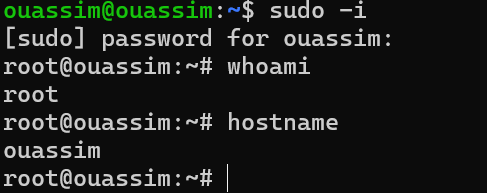

### Vérification du système

```bash
cat /etc/os-release
ip -br a
free -h
df -h /
```

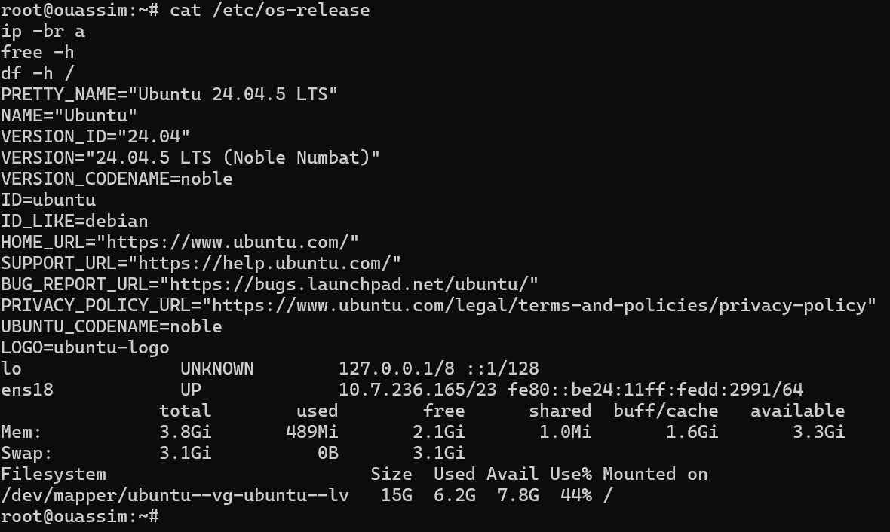

---

## 5. 🔐 Configuration de la clé SSH du professeur

Vérification des clés publiques présentes dans les fichiers authorized_keys.

```bash
ssh-keygen -lf /root/.ssh/authorized_keys
ssh-keygen -lf /home/ouassim/.ssh/authorized_keys
```

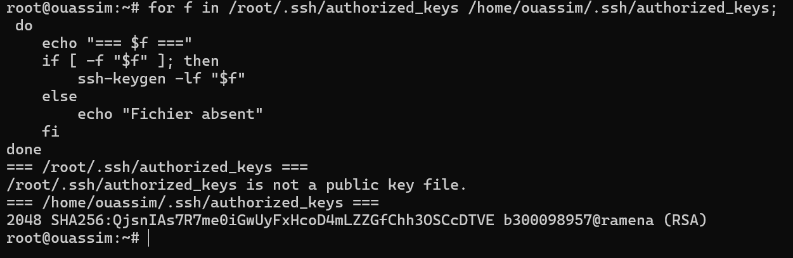

Le fichier authorized_keys du compte root était vide.

```bash
ls -l /root/.ssh/authorized_keys
wc -l /root/.ssh/authorized_keys
```

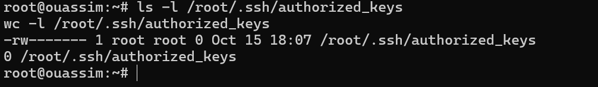

La clé publique du professeur était déjà présente dans le compte ouassim.

Elle a été ajoutée au compte root.

```bash
mkdir -p /root/.ssh
chmod 700 /root/.ssh

cat /home/ouassim/.ssh/authorized_keys >> /root/.ssh/authorized_keys

chmod 600 /root/.ssh/authorized_keys
chown -R root:root /root/.ssh
```

Vérification :

```bash
ssh-keygen -lf /root/.ssh/authorized_keys

sshd -T | grep -E 'permitrootlogin|pubkeyauthentication'
```

Résultat :

```text
permitrootlogin without-password
pubkeyauthentication yes
```

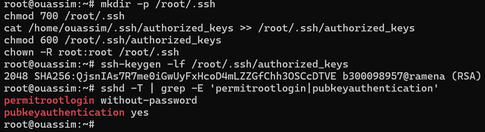

L'authentification SSH du compte root par mot de passe est interdite. L'authentification par clé publique est autorisée.

La connexion réelle du professeur reste à confirmer.

---

## 6. 📡 Installation de Node Exporter

Node Exporter expose les métriques du système Linux.

### Installation

```bash
apt update
apt install -y prometheus-node-exporter
systemctl enable --now prometheus-node-exporter
```

### Vérification

```bash
systemctl status prometheus-node-exporter --no-pager
ss -lntp | grep 9100
```

### Consultation des métriques

```bash
curl -s http://localhost:9100/metrics
```

Exemples de métriques disponibles :

| Métrique | Description |
|---|---|
| node_cpu_seconds_total | Activité du processeur |
| node_memory_MemAvailable_bytes | Mémoire disponible |
| node_filesystem_avail_bytes | Espace disque disponible |
| node_network_receive_bytes_total | Données réseau reçues |
| node_network_transmit_bytes_total | Données réseau envoyées |

Le service a été vérifié avec succès depuis le terminal Ubuntu.

---

## 7. 📈 Installation de Prometheus

Prometheus collecte et stocke les métriques fournies par Node Exporter.

### Installation

```bash
apt install -y prometheus
systemctl enable --now prometheus
```

### Vérification

```bash
systemctl status prometheus --no-pager
prometheus --version
```

Version installée : **2.45.3+ds**.

### Configuration de la collecte

Le fichier principal de configuration est :

```text
/etc/prometheus/prometheus.yml
```

La cible Node Exporter utilise les paramètres suivants :

```yaml
- job_name: node
  scrape_interval: 15s
  static_configs:
    - targets:
        - localhost:9100
```

Prometheus collecte également ses propres métriques sur le port 9090.

### Vérification de l'API

```bash
curl -s http://localhost:9090/api/v1/targets | python3 -m json.tool
```

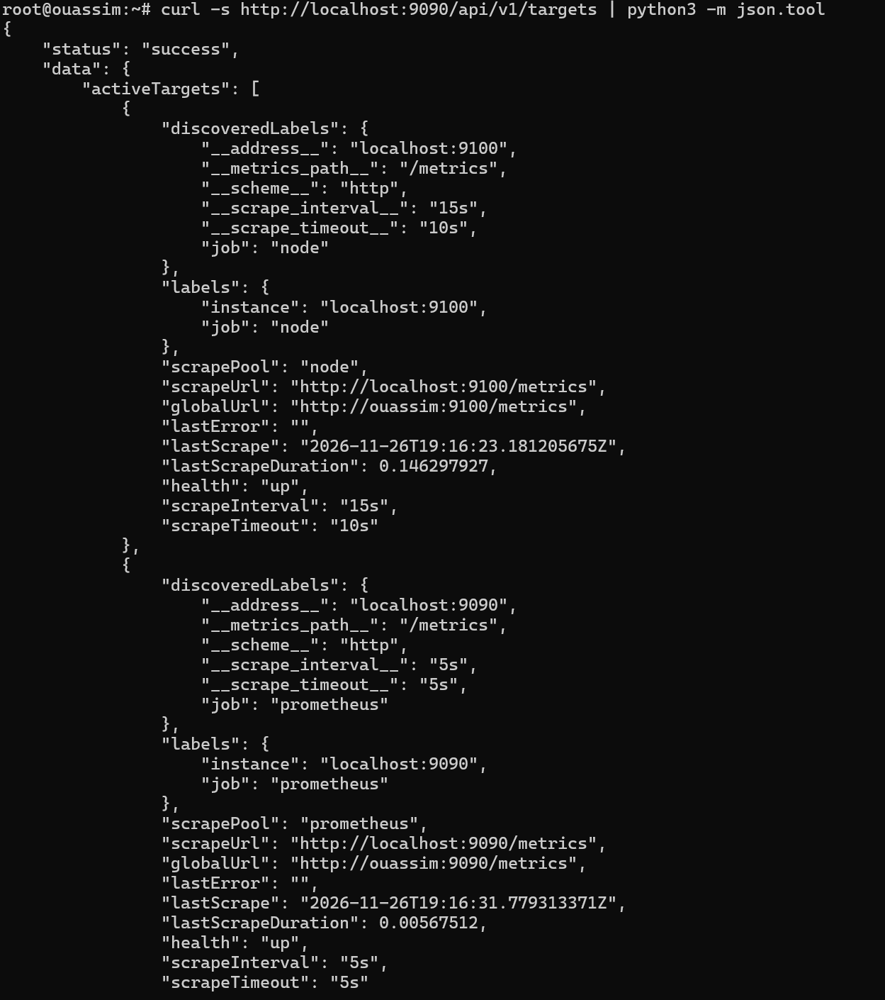

Les deux cibles retournent un état UP sans erreur de collecte.

---

## 8. 🔧 Diagnostic et résolution du problème 404

Lors du premier accès à l'interface Web de Prometheus, l'adresse suivante retournait une erreur :

```text
http://10.7.236.165:9090/targets
```

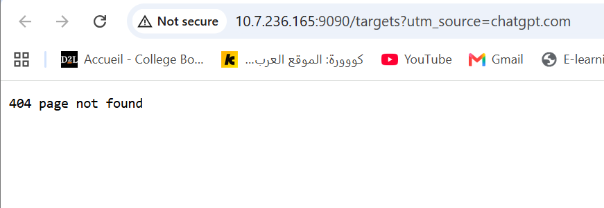

### Diagnostic

Les vérifications suivantes ont été réalisées :

```bash
ss -lntp | grep 9090
systemctl status prometheus
prometheus --version
cat /etc/default/prometheus
```

L'API Prometheus fonctionnait correctement et le port 9090 était en écoute.

Le problème concernait donc le chemin d'accès à l'interface Web et non le fonctionnement de la collecte.

### Solution

Utilisation de l'interface classique de Prometheus :

```text
http://10.7.236.165:9090/classic/targets
```

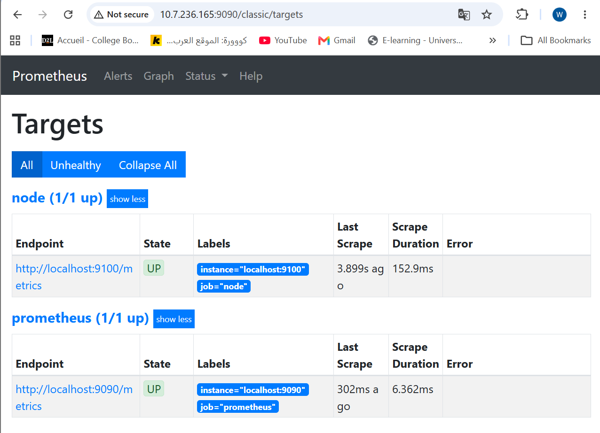

| Cible | État |
|---|---|
| Node Exporter | 🟢 UP |
| Prometheus | 🟢 UP |

Le problème a été résolu sans réinstaller Prometheus.

---

## 9. 📊 Installation de Grafana

Grafana permet de transformer les métriques collectées en graphiques et tableaux de bord.

### Installation

Après configuration du dépôt APT de Grafana :

```bash
apt update
apt install -y grafana
```

### Activation du service

```bash
systemctl daemon-reload
systemctl enable --now grafana-server
systemctl status grafana-server --no-pager
```

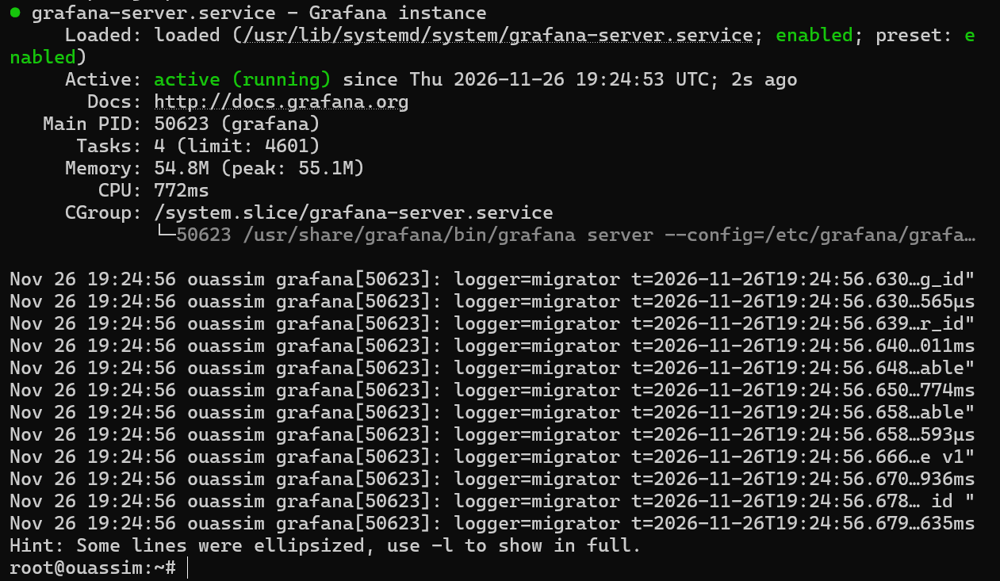

Version installée : **Grafana 13.3.2**.

### Accès à l'interface Web

```text
http://10.7.236.165:3000
```

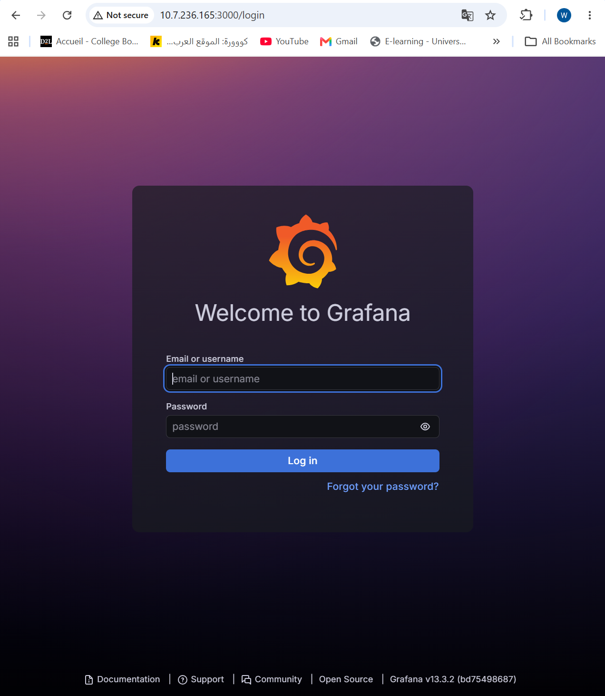

Le mot de passe administrateur initial a été modifié.

Aucun mot de passe n'est publié dans cette documentation.

---

## 10. 🔗 Connexion de Grafana à Prometheus

Dans l'interface Grafana :

1. Ouvrir Connections.
2. Sélectionner Data sources.
3. Ajouter une source Prometheus.
4. Configurer l'adresse du serveur.
5. Cliquer sur Save & test.

Adresse utilisée :

```text
http://localhost:9090
```

Grafana et Prometheus étant installés sur la même machine virtuelle, la communication utilise localhost.

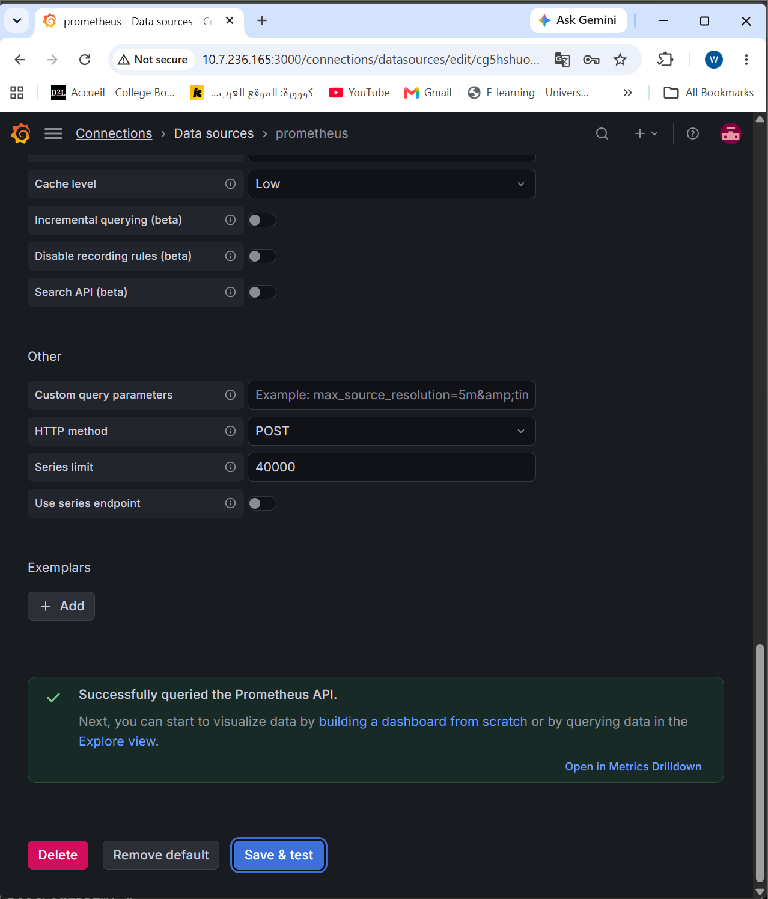

Le message suivant confirme la réussite du test :

> Successfully queried the Prometheus API.

---

## 11. 📉 Configuration du tableau de bord

Le tableau de bord communautaire **Node Exporter Full**, publié par rfmoz, a été utilisé.

| Paramètre | Valeur |
|---|---|
| Dashboard ID | 1860 |
| Nom | Node Exporter Full |
| Data source | prometheus |
| Job | node |
| Nodename | ouassim |
| Instance | localhost:9100 |

### Importation

Dans Grafana :

1. Ouvrir Dashboards.
2. Cliquer sur New.
3. Sélectionner Import.
4. Entrer l'identifiant 1860.
5. Cliquer sur Load.
6. Cliquer sur Import.

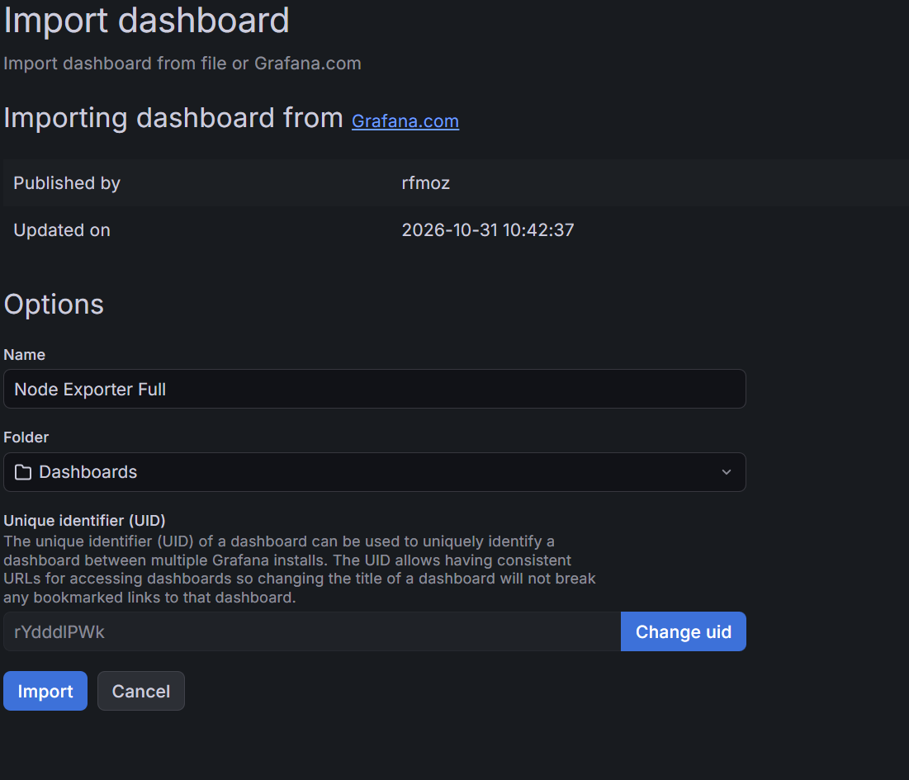

### Résultat

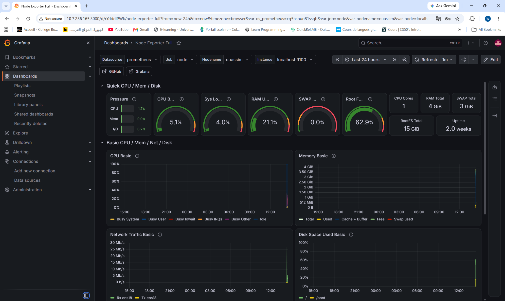

Les métriques affichées proviennent réellement de la machine virtuelle Ubuntu.

| Indicateur | Valeur observée |
|---|---|
| CPU | 5,1 % |
| RAM utilisée | 21,1 % |
| Disque système utilisé | 62,9 % |
| SWAP utilisée | 0 % |
| CPU disponibles | 1 |
| RAM totale | 4 Gio |
| Uptime | Environ 2 semaines |

Ces valeurs correspondent à une capture effectuée pendant la réalisation du projet.

---

## 12. 🧪 Test de charge CPU

Pour vérifier le fonctionnement dynamique du monitoring, une charge temporaire a été générée sur le processeur.

```bash
timeout 60s yes > /dev/null
```

Cette commande sollicite le processeur pendant une durée maximale de 60 secondes.

### Pendant le test

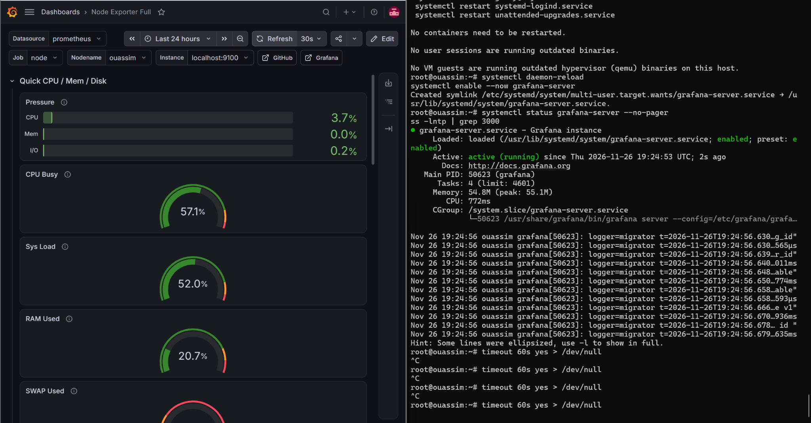

Le CPU atteint 57,1 % sur cette première capture.

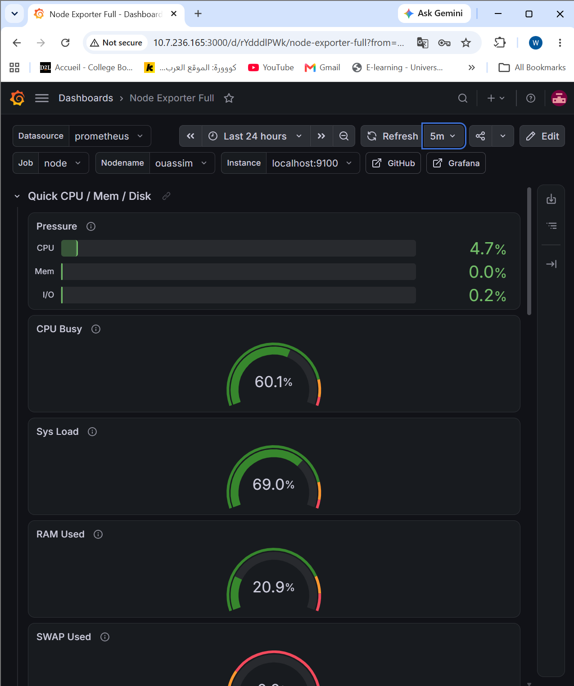

Une utilisation de 60,1 % est également observée.

### Observation sur cinq minutes

La période d'affichage du dashboard a été modifiée afin de faciliter l'observation des variations.

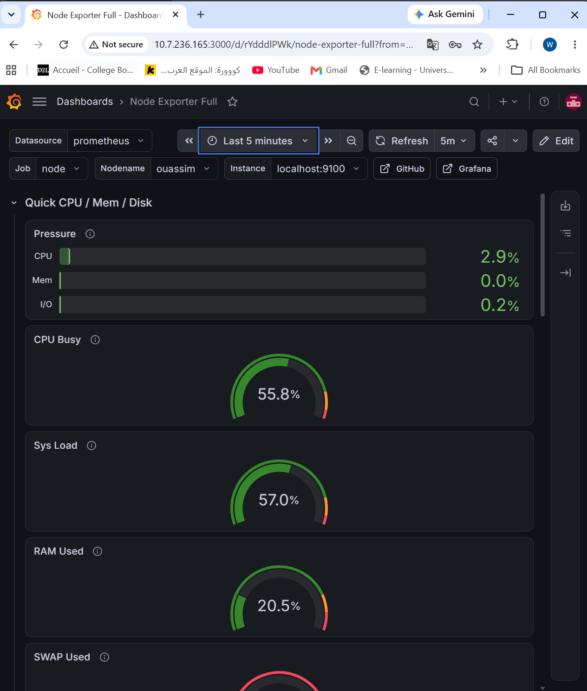

### Après le test

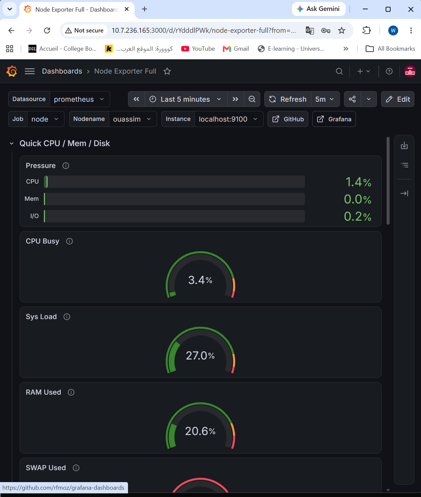

### Résultats

| Phase | Utilisation CPU |
|---|---:|
| Avant le test | 5,1 % |
| Pendant le test | 60,1 % |
| Après le test | 3,4 % |

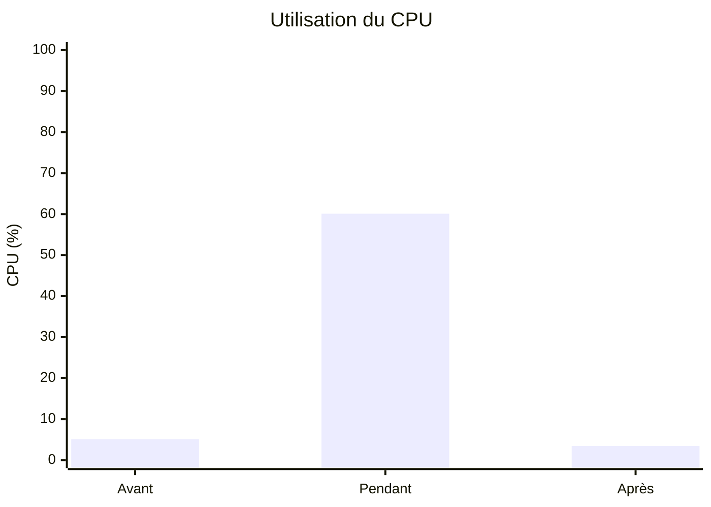

Le test démontre que Node Exporter, Prometheus et Grafana permettent de détecter une augmentation de la charge CPU puis un retour à une utilisation normale.

---

## 13. ✅ Validation des services

```bash
systemctl is-active prometheus-node-exporter prometheus grafana-server

systemctl is-enabled prometheus-node-exporter prometheus grafana-server

ss -lntp | grep -E ':(3000|9090|9100)\b'

df -h /
```

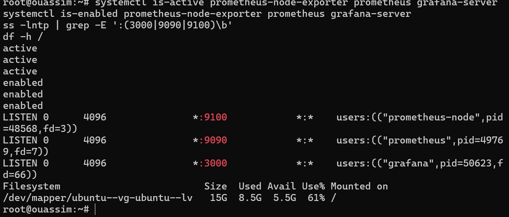

| Service | État | Démarrage automatique |
|---|---|---|
| Node Exporter | 🟢 Active | Enabled |
| Prometheus | 🟢 Active | Enabled |
| Grafana | 🟢 Active | Enabled |

### Stockage après installation

| Indicateur | Valeur |
|---|---|
| Partition système | 15 Gio |
| Espace utilisé | 8,5 Gio |
| Espace disponible | 5,5 Gio |
| Taux d'utilisation | 61 % |

---

## 14. 🛡️ Sécurité du serveur

### Vérification des comptes de service

```bash
ps -eo user,comm | grep -E 'prometheus|grafana'
ufw status
sshd -T | grep -E 'permitrootlogin|pubkeyauthentication'
```

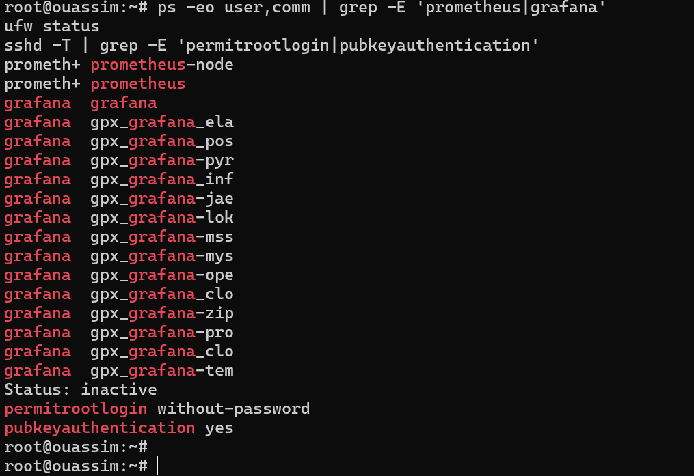

Les services Prometheus, Node Exporter et Grafana utilisent des comptes dédiés.

Ils ne sont pas exécutés directement avec le compte root.

### Vérification des connexions réseau

Avant l'activation du pare-feu :

```bash
ss -tnp state established '( sport = :22 or sport = :3000 )'
```

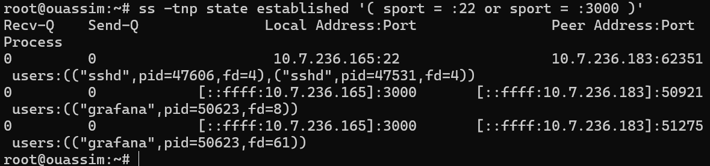

Cette vérification permet de confirmer que le poste client appartient au sous-réseau autorisé.

---

## 15. 🔥 Configuration du pare-feu UFW

Le pare-feu était initialement désactivé.

Les règles suivantes ont été configurées :

```bash
ufw default deny incoming
ufw default allow outgoing

ufw allow 22/tcp

ufw allow from 10.7.236.0/23 to any port 3000 proto tcp
ufw allow from 10.7.236.0/23 to any port 9090 proto tcp
ufw allow from 10.7.236.0/23 to any port 9100 proto tcp

ufw enable
ufw status verbose
```

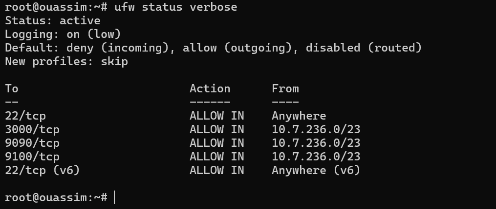

### Règles de sécurité

| Port | Service | Accès autorisé |
|---|---|---|
| 22/TCP | SSH | Toutes les adresses |
| 3000/TCP | Grafana | 10.7.236.0/23 |
| 9090/TCP | Prometheus | 10.7.236.0/23 |
| 9100/TCP | Node Exporter | 10.7.236.0/23 |
| Autres connexions entrantes | — | Refusées par défaut |

Le port SSH reste accessible afin de préserver l'accès administratif et celui du professeur.

Les interfaces de monitoring sont limitées au sous-réseau autorisé.

---

## 16. 🌐 Validation réseau depuis Windows

Après l'activation du pare-feu, les quatre ports ont été testés depuis PowerShell.

```powershell
22,3000,9090,9100 | ForEach-Object {
    Test-NetConnection 10.7.236.165 -Port $_ |
    Select-Object RemotePort,TcpTestSucceeded
}
```

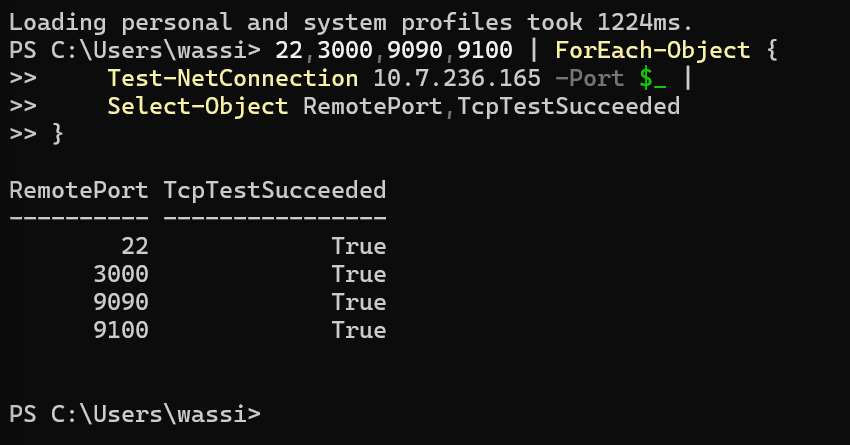

| Port | Résultat |
|---|---|
| 22 | ✅ True |
| 3000 | ✅ True |
| 9090 | ✅ True |
| 9100 | ✅ True |

Les quatre tests de connectivité TCP ont réussi après l'activation du pare-feu.

---

## 17. 📋 Bilan du projet

- [x] Préparation de la machine virtuelle Ubuntu.
- [x] Administration avec le compte root.
- [x] Ajout de la clé publique du professeur.
- [x] Installation de Node Exporter.
- [x] Installation de Prometheus.
- [x] Vérification de la collecte des métriques.
- [x] Installation de Grafana.
- [x] Connexion de Grafana à Prometheus.
- [x] Importation du tableau de bord.
- [x] Test de charge CPU.
- [x] Validation des services.
- [x] Configuration du pare-feu UFW.
- [x] Validation de la connectivité réseau.
- [x] Documentation avec captures d'écran.

---

## 18. 🚀 Améliorations futures

Le projet est fonctionnel dans son environnement de laboratoire.

Des améliorations supplémentaires sont possibles :

- Configurer HTTPS pour sécuriser les interfaces Web.
- Configurer des alertes en cas de surcharge CPU.
- Ajouter des alertes pour l'espace disque.
- Surveiller plusieurs serveurs Linux.
- Renforcer les mots de passe administratifs.
- Restreindre davantage les accès réseau selon les besoins.
- Redémarrer la VM pour appliquer la mise à jour du noyau et vérifier la persistance des services.
- Confirmer la connexion SSH réelle du professeur.

---

## 19. 📚 Références

- [Ubuntu Server](https://ubuntu.com/server)
- [Prometheus Documentation](https://prometheus.io/docs/)
- [Node Exporter](https://github.com/prometheus/node_exporter)
- [Grafana Documentation](https://grafana.com/docs/)
- [Node Exporter Full — Dashboard 1860](https://grafana.com/grafana/dashboards/1860-node-exporter-full/)
- [Proxmox VE](https://www.proxmox.com/en/)

---

## 20. 📝 Conclusion

Ce projet m'a permis de mettre en place une solution de monitoring Linux complète avec Node Exporter, Prometheus et Grafana.

J'ai appris à installer et administrer des services Linux, à collecter des métriques, à configurer un tableau de bord et à diagnostiquer un problème d'accès Web.

Le test de charge CPU a démontré que le système détecte les variations d'utilisation des ressources.

La configuration du pare-feu UFW permet également de limiter les accès réseau tout en conservant les fonctionnalités nécessaires.

Ce projet constitue une base pratique pour l'administration système, le Cloud et les environnements DevOps.

---

**🐧 INF1085 — Administration Linux**

**Ouassim Ahmed Benamira — 300150564**