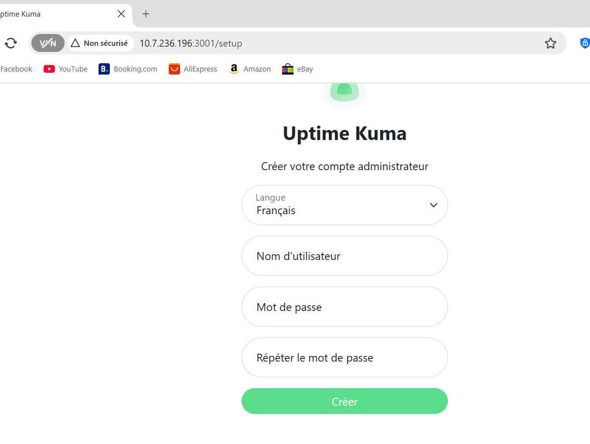
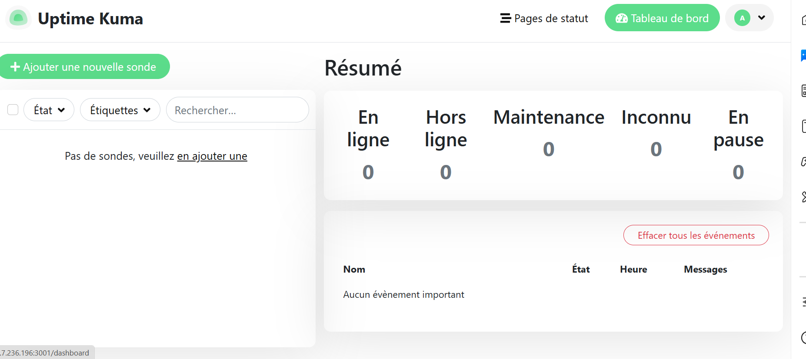
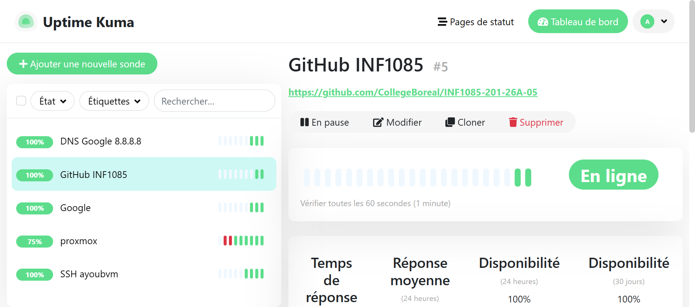
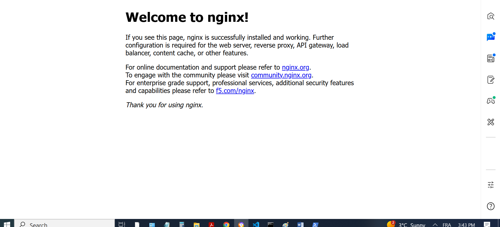
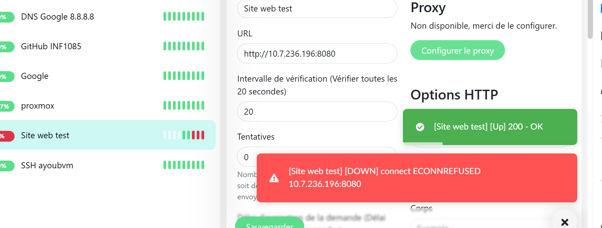

# 📡 Projet – Surveillance de services avec Uptime Kuma

**Nom :** Toumi Ayoub · **ID :** 300151315

## 1. Présentation du projet

**Uptime Kuma** est un outil libre de surveillance (*monitoring*) : il vérifie à intervalle régulier que des sites web, des serveurs et des services répondent, garde l'historique de disponibilité, et affiche une **page de statut** publique.

Objectif : surveiller mon serveur Proxmox, ma VM et quelques services Internet depuis ma VM, et détecter automatiquement une panne.

## 2. Environnement

| Élément | Valeur |
|---------|--------|
| Serveur physique | Proxmox VE — `10.7.236.197` |
| VM | `ayoubvm` — Ubuntu 24.04.5 LTS, 2 vCPU, 4 Go RAM, disque 30 Go |
| IP de la VM | `10.7.236.196` |
| Docker | 29.1.3 + Docker Compose 2.40 |
| Uptime Kuma | 2.5.12 (image `louislam/uptime-kuma:2`) |
| Accès | http://10.7.236.196:3001 |

## 3. Installation

### Docker

```bash
sudo apt update
sudo apt install -y docker.io docker-compose-v2
sudo systemctl enable --now docker
sudo usermod -aG docker ayoub
```

### Uptime Kuma avec Docker Compose

`~/uptime-kuma/compose.yaml` :

```yaml
services:
  uptime-kuma:
    image: louislam/uptime-kuma:2
    container_name: uptime-kuma
    restart: unless-stopped
    ports:
      - "3001:3001"
    volumes:
      - ./data:/app/data
```

```bash
cd ~/uptime-kuma
sudo docker compose up -d
sudo docker ps
```

```
uptime-kuma | louislam/uptime-kuma:2 | Up 17 minutes (healthy) | 0.0.0.0:3001->3001/tcp
```

- `restart: unless-stopped` : le conteneur redémarre tout seul avec la VM.
- `./data:/app/data` : la base SQLite (sondes, historique) reste sur la VM même si le conteneur est recréé.

### Compte administrateur

Premier accès à http://10.7.236.196:3001 : base de données **SQLite**, puis création du compte admin.





## 4. Sondes (monitors)

| Sonde | Type | Cible | Ce qui est vérifié |
|-------|------|-------|--------------------|
| proxmox | HTTP(s) | `https://10.7.236.197:8006` | interface web Proxmox (erreurs TLS ignorées : certificat auto-signé) |
| SSH ayoubvm | Port TCP | `10.7.236.196:22` | le service SSH de ma VM |
| Google | HTTP(s) | `https://www.google.com` | accès Internet (web) |
| DNS Google 8.8.8.8 | Ping | `8.8.8.8` | accès Internet (réseau) |
| GitHub INF1085 | HTTP(s) | dépôt du cours | accès à GitHub |
| Site web test | HTTP(s) | `http://10.7.236.196:8080` | un site Nginx de test (intervalle 20 s) |



## 5. Page de statut publique

Page **Statut Ayoub** : http://10.7.236.196:3001/status/ayoub — visible sans connexion, avec les 5 premières sondes.

> Résultat : **« Tous les systèmes sont opérationnels »**

## 6. Test de panne

Un petit site Nginx a été lancé dans un conteneur pour simuler une panne :

```bash
sudo docker run -d --name site-test --restart unless-stopped -p 8080:80 nginx:alpine
```



Puis arrêté :

```bash
sudo docker stop site-test
```

Uptime Kuma détecte la panne en **4 secondes** (sonde toutes les 20 s) :

```
20:45:17  DOWN  connect ECONNREFUSED 10.7.236.196:8080
20:45:37  DOWN  connect ECONNREFUSED 10.7.236.196:8080
20:45:57  DOWN  connect ECONNREFUSED 10.7.236.196:8080
```

Après `sudo docker start site-test`, le site revient **en ligne** (`200 - OK`).



## 7. Problèmes rencontrés et solutions

| Problème | Solution |
|----------|----------|
| SSH refusé (`Permission denied`) : la VM n'avait plus ma clé | Copie de la clé depuis PowerShell : `type $env:USERPROFILE\.ssh\id_ed25519.pub \| ssh ayoub@10.7.236.196 "cat >> .ssh/authorized_keys"` |
| « This Uptime Kuma version is outdated » (v1) | Image changée pour `louislam/uptime-kuma:2` |
| Bouton *Create* bloqué : le navigateur gardait l'ancienne page v1 | Base SQLite choisie dans `data/db-config.json`, redémarrage du conteneur, puis rechargement de la page |
| Sonde Proxmox `getaddrinfo ENOTFOUND https` | Faute dans l'URL ; corrigée en `https://10.7.236.197:8006` |
| Certificat Proxmox auto-signé | Option *Ignorer les erreurs TLS/SSL* |

## 8. Conclusion

Uptime Kuma, installé en quelques minutes avec Docker Compose, surveille en continu mon serveur Proxmox, ma VM et des services Internet. Le test de panne montre qu'un service arrêté est détecté presque immédiatement, et la page de statut donne une vue claire de l'état de tous les services.
