# Projet MediaWiki — Wiki d'Anis

**Étudiant :** Anis Ouhocine (300151496)
**Cours :** INF1085 — Projet de fin de session
**Date :** 26 novembre 2026
**Dépôt :** `6.Projects/300151496`

## 1. Présentation du projet

La consigne du professeur est de « créer un projet sur votre machine virtuelle (VM) ».
Le projet choisi est **Wikipedia** : installer et configurer **MediaWiki 1.46.2**
(le logiciel qui fait fonctionner Wikipédia) sur la machine virtuelle AnisHcn,
pour créer un site de documentation consultable en réseau local :
le **Wiki d'Anis**, accessible à http://10.7.236.168/mediawiki/.

Le wiki contient une page d'accueil personnalisée et trois pages :
**Linux**, **Proxmox** et **MediaWiki**.

Le wiki est bilingue : chaque page existe en français et en arabe
(voir section 6).

## 2. Architecture

| Élément | Détail |
|---|---|
| Serveur Proxmox | 10.7.236.197 (nœud server197) |
| Machine virtuelle | 100 « AnisHcn » — Ubuntu Server 24.04.5, 2 Go de RAM, 2 cœurs, disque 20 Go (nvme-storage) |
| Adresse IP de la VM | 10.7.236.168/23 (statique), passerelle 10.7.237.1 |
| Serveur web | Apache 2 |
| Base de données | MariaDB 10.11.14, base `wikidb`, utilisateur `wikiuser` |
| Langage | PHP 8.3.6 |
| Logiciel wiki | MediaWiki 1.46.2 |

## 3. Réalisation étape par étape

### Étape A — Accès à la machine virtuelle

La VM est allumée et son adresse est bien `10.7.236.168/23` (interface `ens18`).
La connexion SSH fonctionne depuis le portable :
`ssh anishcn@10.7.236.168`.

### Étape B — DNS

`apt update` échouait avec « Temporary failure in name resolution ».
Diagnostic : `ping 8.8.8.8` fonctionnait, mais `ping ca.archive.ubuntu.com`
ne résolvait pas — le DNS du collège (10.7.237.1) ne répondait pas.
Correctif temporaire : `resolvectl dns ens18 8.8.8.8 1.1.1.1`.
Puis correctif permanent dans `/etc/netplan/50-cloud-init.yaml` :
la ligne `nameservers` est passée de `[10.7.237.1]` à `[8.8.8.8, 1.1.1.1]`
(IP et passerelle inchangées), validé par `netplan generate`, puis appliqué
par `netplan apply`. Vérification :

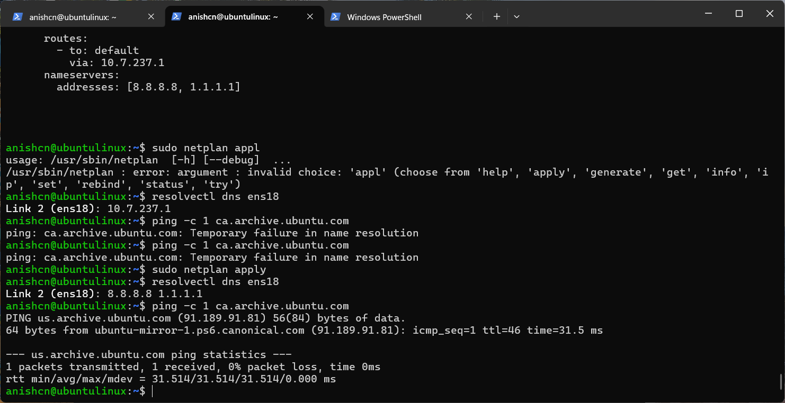

`resolvectl dns ens18` affiche `8.8.8.8 1.1.1.1` et
`ping ca.archive.ubuntu.com` répond (91.189.91.81, 31,5 ms).

### Étape C — Apache

Installation : `sudo apt install -y apache2`.
`systemctl status apache2` : **active (running)**.
La page par défaut est visible à http://10.7.236.168
(« Apache2 Ubuntu Default Page »).

**Problème : le réseau du collège bloque les téléchargements directs.**
Les ports 80 et 443 vers les miroirs Ubuntu et Wikimedia sont bloqués ;
seuls 8.8.8.8 et 1.1.1.1 sont joignables en TCP. La VM ne peut donc rien
télécharger directement. Solution retenue : passer par le portable comme
proxy SOCKS (voir étape D).

### Étape D — MariaDB et tunnel SOCKS

Le portable sert de proxy : un tunnel SSH inversé est ouvert depuis le
portable (`ssh -N -R 1080 anishcn@10.7.236.168`) et apt est configuré
pour l'utiliser (`/etc/apt/apt.conf.d/99proxy` →
`socks5h://127.0.0.1:1080`).

Installation : `sudo apt install -y mariadb-server`, puis
`sudo mysql_secure_installation` (utilisateurs anonymes supprimés,
connexion root à distance interdite, base de test supprimée).
`systemctl status mariadb` : **active (running)**.

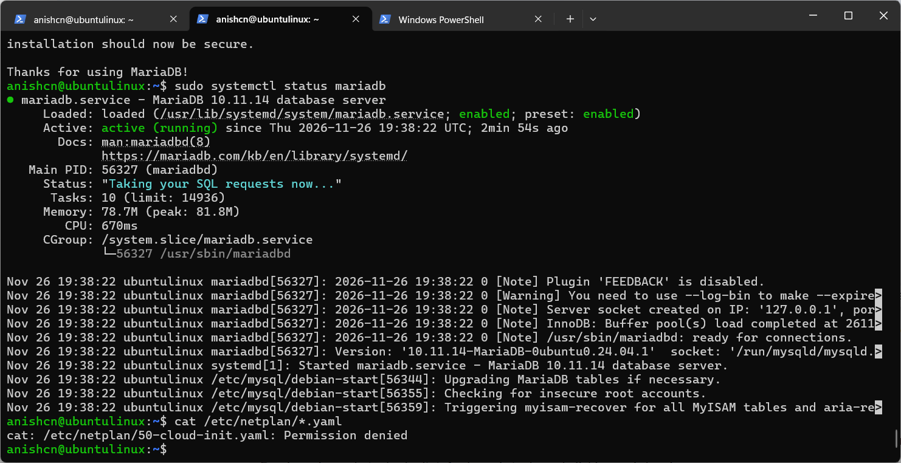

### Étape E — PHP

Installation :
`sudo apt install -y php libapache2-mod-php php-mysql php-mbstring php-xml php-intl php-apcu php-curl php-gd`.
`php -v` : **PHP 8.3.6**.

### Étape F — Base de données du wiki

```sql
CREATE DATABASE wikidb;
CREATE USER 'wikiuser'@'localhost' IDENTIFIED BY '<mot de passe>';
GRANT ALL PRIVILEGES ON wikidb.* TO 'wikiuser'@'localhost';
FLUSH PRIVILEGES;
```

Vérification : `wikidb` apparaît dans `SHOW DATABASES` et
`wikiuser | localhost` dans la table des utilisateurs.

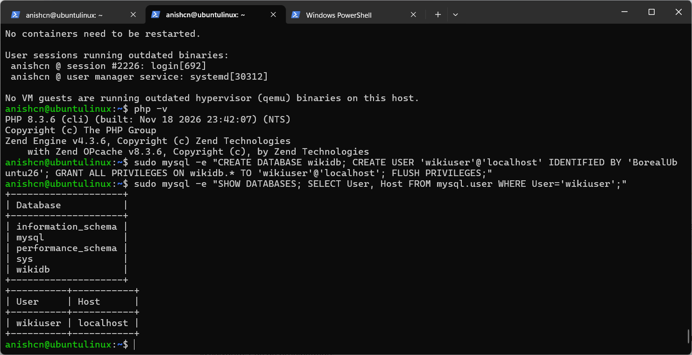

### Étape G — Téléchargement de MediaWiki

`wget` ne gère pas SOCKS, le téléchargement se fait avec `curl` via le tunnel :

```
cd /tmp
curl --socks5-hostname 127.0.0.1:1080 -O https://releases.wikimedia.org/mediawiki/1.46/mediawiki-1.46.2.tar.gz
```

Résultat : **94,4 Mo téléchargés en 13 secondes**.

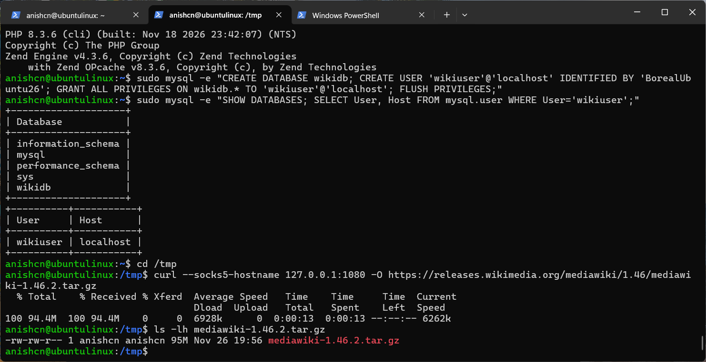

### Étape H — Extraction

```
sudo tar -xzf mediawiki-1.46.2.tar.gz -C /var/www/html/
sudo mv /var/www/html/mediawiki-1.46.2 /var/www/html/mediawiki
sudo chown -R www-data:www-data /var/www/html/mediawiki
```

`ls /var/www/html/` montre `index.html` et `mediawiki`.

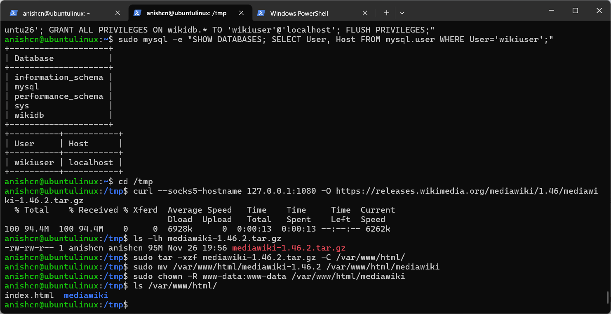

### Étape I — Installateur web

L'installateur est lancé à http://10.7.236.168/mediawiki/.
Les vérifications d'environnement passent (PHP 8.3.6, ICU 74.2) :
« L'environnement a été vérifié. Vous pouvez installer MediaWiki. »

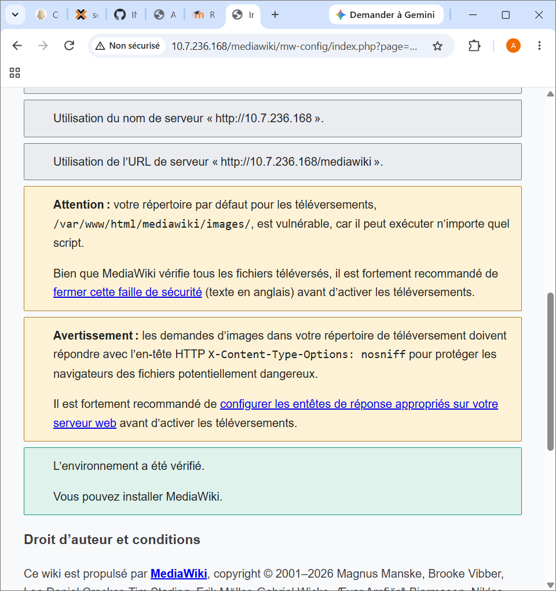

Paramètres utilisés :

- Base de données : MariaDB, hôte `localhost`, base `wikidb`,
  utilisateur `wikiuser`, pas de préfixe de table.
- Nom du wiki : **Wiki d'Anis**, compte administrateur `anishcn`.
- Habillage par défaut : **Vector**, mise en cache APCu.

L'installation se termine par « Félicitations ! Vous avez installé MediaWiki. »
et le fichier `LocalSettings.php` est téléchargé.

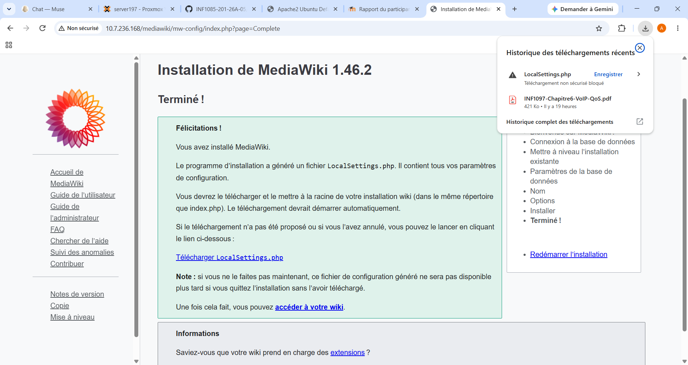

### Étape J — LocalSettings.php

Le fichier est copié dans la VM par `scp`, puis placé à la racine du wiki :

```
scp C:\Users\Admin\Downloads\LocalSettings.php anishcn@10.7.236.168:/home/anishcn/
sudo mv /home/anishcn/LocalSettings.php /var/www/html/mediawiki/LocalSettings.php
sudo chown www-data:www-data /var/www/html/mediawiki/LocalSettings.php
```

Le wiki s'affiche alors à http://10.7.236.168/mediawiki/ :

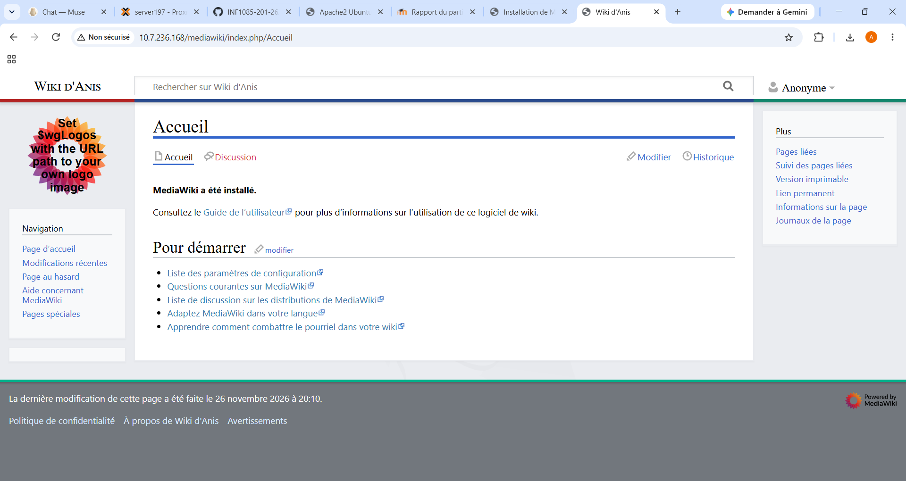

### Étape K — Contenu

Après connexion avec le compte administrateur `anishcn`, la page d'accueil
est personnalisée (présentation du projet, caractéristiques, liens vers les
pages) et trois pages sont créées :

- **Linux** — le système d'exploitation de la machine virtuelle.
- **Proxmox** — la plateforme de virtualisation qui héberge la machine virtuelle.
- **MediaWiki** — le logiciel wiki installé sur la machine virtuelle.


## 4. Problèmes rencontrés et solutions

| Problème | Solution |
|---|---|
| Conflit d'adresse IP : un autre appareil utilise 10.7.236.168 sur le réseau local, SSH refuse la connexion (« REMOTE HOST IDENTIFICATION HAS CHANGED ») | `arp -d 10.7.236.168` sur le portable, puis SSH en direct ; à long terme, demander une autre adresse IP statique au professeur |
| DNS du collège (10.7.237.1) ne résout pas | DNS remplacé par 8.8.8.8 et 1.1.1.1, rendu permanent dans netplan |
| Ports 80/443 bloqués vers les miroirs : la VM ne peut rien télécharger | Tunnel SOCKS inversé depuis le portable (`ssh -N -R 1080`), proxy apt en `socks5h://127.0.0.1:1080` |
| Commande tapée dans la mauvaise fenêtre (Linux dans PowerShell, tunnel dans la VM) | Toujours vérifier le prompt : `anishcn@ubuntulinux` = VM, `PS C:\Users\Admin>` = portable |
| Installateur : hôte de la base rempli avec `wikidb` au lieu de `localhost` | Corrigé avant de continuer |
| Installateur : « L'habillage choisi par défaut doit être activé » | Aucun habillage n'était choisi par défaut : le bouton « Utiliser cet habillage par défaut » sous Vector a été coché |
| Chrome bloque le téléchargement de `LocalSettings.php` (site HTTP) | Cliqué sur « Enregistrer » dans le panneau des téléchargements |

## 5. Résultat

Le **Wiki d'Anis** fonctionne à http://10.7.236.168/mediawiki/ :
page d'accueil personnalisée, trois pages de contenu, recherche,
historique des modifications, compte administrateur `anishcn`.

### Page Linux

La page Linux présente le système d'exploitation de la machine virtuelle :
le noyau Linux, la distribution Ubuntu Server 24.04 (sans interface
graphique, administrée par SSH), les caractéristiques de la VM AnisHcn
et les services installés (Apache 2, MariaDB 10.11, PHP 8.3).

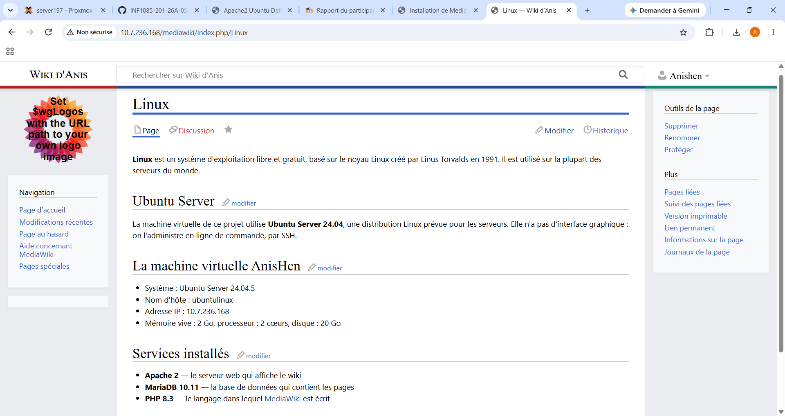

### Page Proxmox

La page Proxmox présente la plateforme de virtualisation : le serveur
du groupe (10.7.236.197), les caractéristiques de la machine virtuelle
AnisHcn et le rôle de Proxmox dans le projet (héberger la VM sur laquelle
tournent Linux, Apache, MariaDB, PHP et MediaWiki).

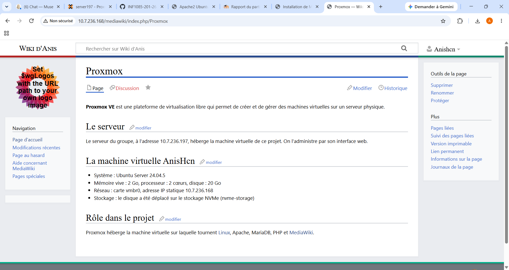

### Page MediaWiki

La page MediaWiki présente le logiciel wiki : son installation
(MediaWiki 1.46.2, archive téléchargée, extraction, base wikidb,
installateur web), son fonctionnement (wikitexte, base de données
MariaDB, serveur Apache avec PHP) et les liens vers les autres pages
du wiki.

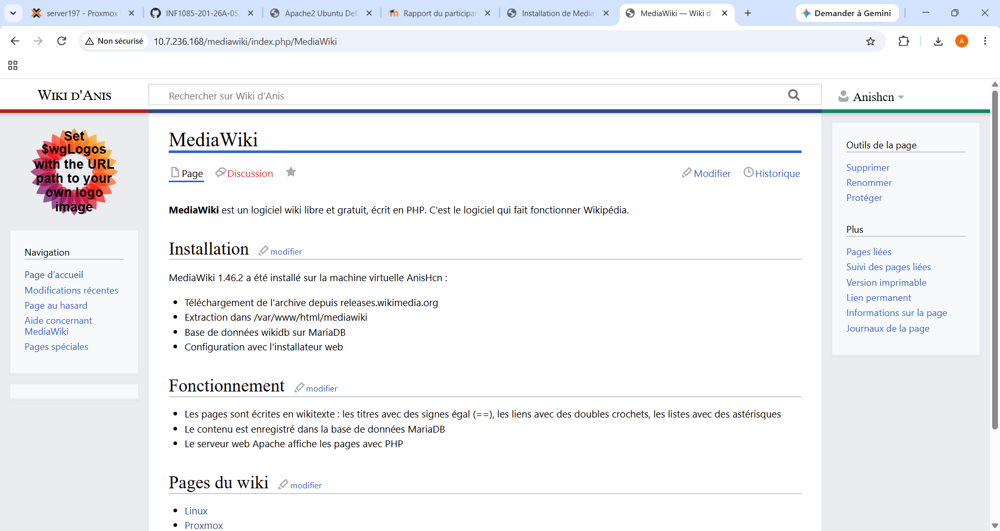

## 6. Amélioration : le wiki en français et en arabe

Après la première version du wiki, le professeur a suggéré d'ajouter
une deuxième langue au wiki. Le kabyle (la langue maternelle de
l'étudiant) a d'abord été envisagé, puis l'arabe a été choisi à la
place. Les raisons de ce choix sont expliquées ci-dessous.

### Pourquoi l'arabe et pas le kabyle

Le kabyle est une langue surtout orale : son vocabulaire technique
informatique n'est pas standardisé. Pour des termes comme « serveur »,
« base de données », « virtualisation », « système d'exploitation » ou
« mémoire vive », il n'existe pas d'équivalent kabyle établi — il
faudrait emprunter les mots français ou inventer des traductions, sans
pouvoir vérifier qu'elles sont correctes. De plus, le kabyle s'écrit
avec des caractères spéciaux (ɣ, ɛ, ḥ, ṭ, ḍ) difficiles à taper sur un
clavier standard et qui peuvent mal s'afficher.

L'arabe, au contraire, possède un vocabulaire technique complet et
standardisé, utilisé dans la documentation informatique et dans
Wikipédia en arabe (l'une des plus grandes versions de Wikipédia).
L'étudiant lit et écrit l'arabe couramment, donc chaque traduction a
pu être relue et vérifiée. MediaWiki affiche l'arabe de droite à
gauche automatiquement, sans aucune configuration.

### Comment les pages arabes ont été créées

Chaque page française a une version arabe, créée comme une sous-page
dont le nom se termine par `/ar` (le code de langue de l'arabe) :

| Page française | Page arabe |
|---|---|
| Accueil | Accueil/ar |
| Linux | Linux/ar |
| Proxmox | Proxmox/ar |
| MediaWiki | MediaWiki/ar |

Méthode pour chaque page : rechercher le nom dans le wiki, cliquer sur
« Créer la page », coller le texte arabe (traduction fidèle de la page
française), puis « Enregistrer la page ». Aucune extension n'est
nécessaire : les liens entre les langues sont de simples liens wiki.

En haut de chaque page arabe, une ligne renvoie vers la version
française, par exemple pour l'accueil :

`''النسخة الفرنسية : [[Accueil|Français]]''`

En haut de chaque page française, une ligne renvoie vers la version
arabe, par exemple pour l'accueil :

`''Version en arabe : [[Accueil/ar|العربية]]''`

Le visiteur voit donc le lien de l'autre langue dès qu'il ouvre une
page, et peut passer d'une langue à l'autre en un clic.

### Correction : la casse des noms de pages

Les pages arabes ont d'abord été créées avec une majuscule :
`Linux/Ar`, `Proxmox/Ar`, `MediaWiki/Ar`, et la page d'accueil avec
une faute d'orthographe : `Acceuil/Ar`. Résultat : les liens entre
les pages s'affichaient en rouge (pages introuvables), car MediaWiki
distingue les majuscules des minuscules dans les noms de pages.

Correction : les quatre pages ont été renommées avec l'outil
« Renommer » (menu « Outils de la page ») en minuscules, avec
l'orthographe corrigée pour l'accueil : `Accueil/ar`, `Linux/ar`,
`Proxmox/ar`, `MediaWiki/ar`. Après le renommage, tous les liens sont
devenus bleus.

### Page d'accueil en arabe

La page d'accueil en arabe reprend la structure de la version
française : présentation du projet, caractéristiques de la machine
virtuelle et liens vers les trois autres pages arabes.

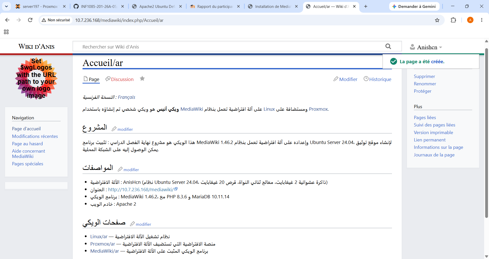

### Page Linux en arabe

La page Linux en arabe présente le système d'exploitation, la
distribution Ubuntu Server 24.04, les caractéristiques de la VM
AnisHcn et les services installés.

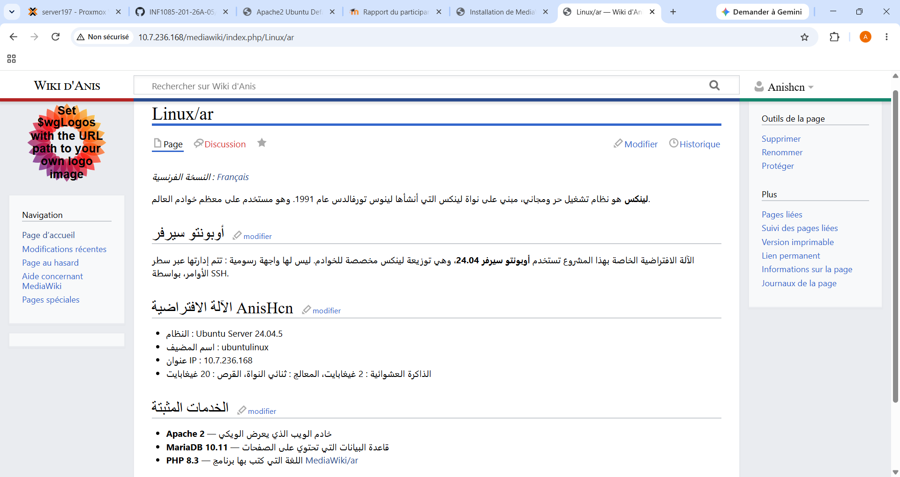

### Page Proxmox en arabe

La page Proxmox en arabe présente la plateforme de virtualisation,
le serveur du groupe et le rôle de Proxmox dans le projet.

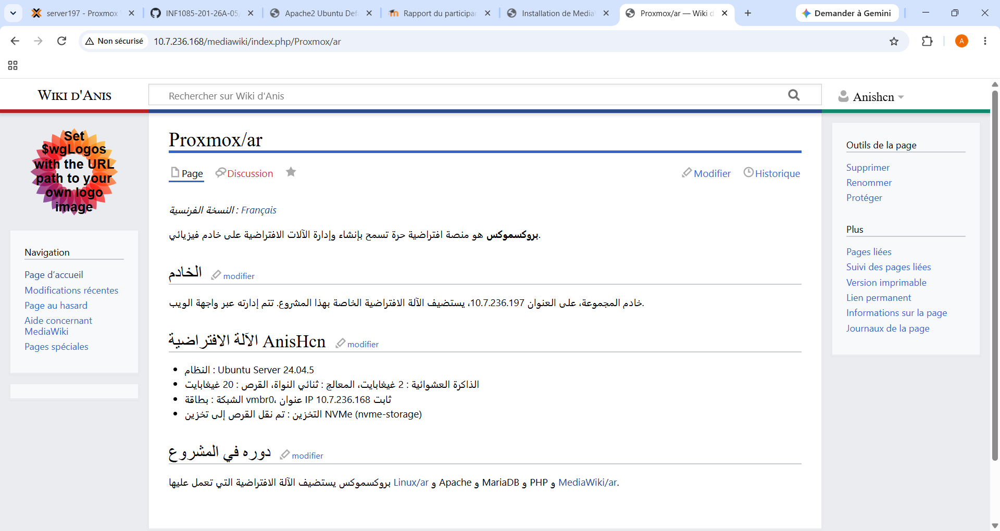

### Page MediaWiki en arabe

La page MediaWiki en arabe présente le logiciel wiki, son
installation et son fonctionnement.

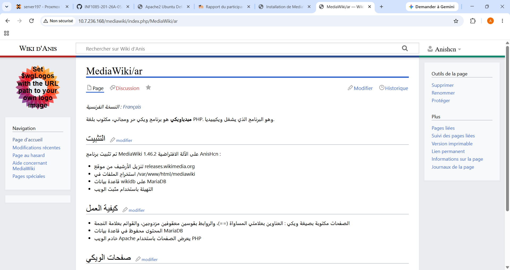

## 7. Conclusion

Le projet est terminé et vérifié à chaque étape : Apache, MariaDB, PHP,
MediaWiki et le contenu sont en place, en français et en arabe. Les deux
points qui restent à régler avec le professeur sont le conflit d'adresse
IP (10.7.236.168 utilisée par un autre appareil) et l'absence de proxy
officiel pour les téléchargements de la VM.
