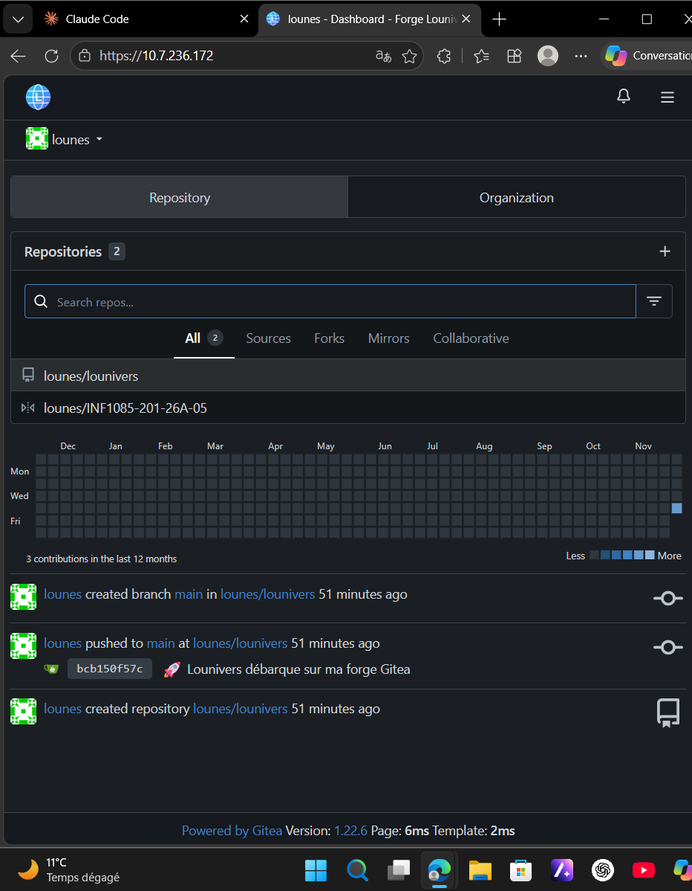
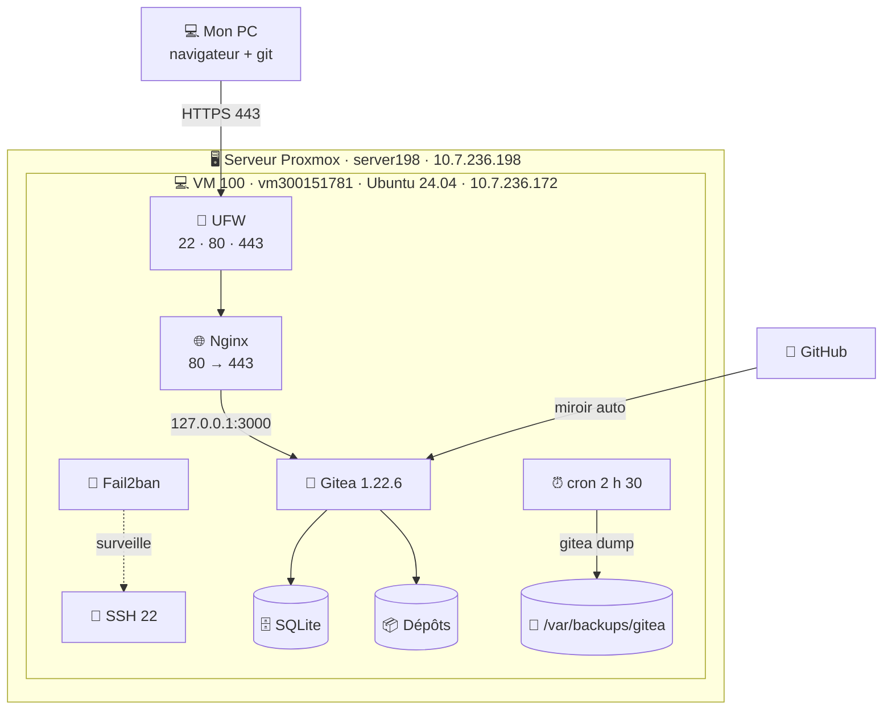
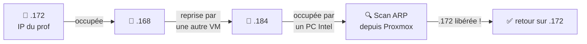
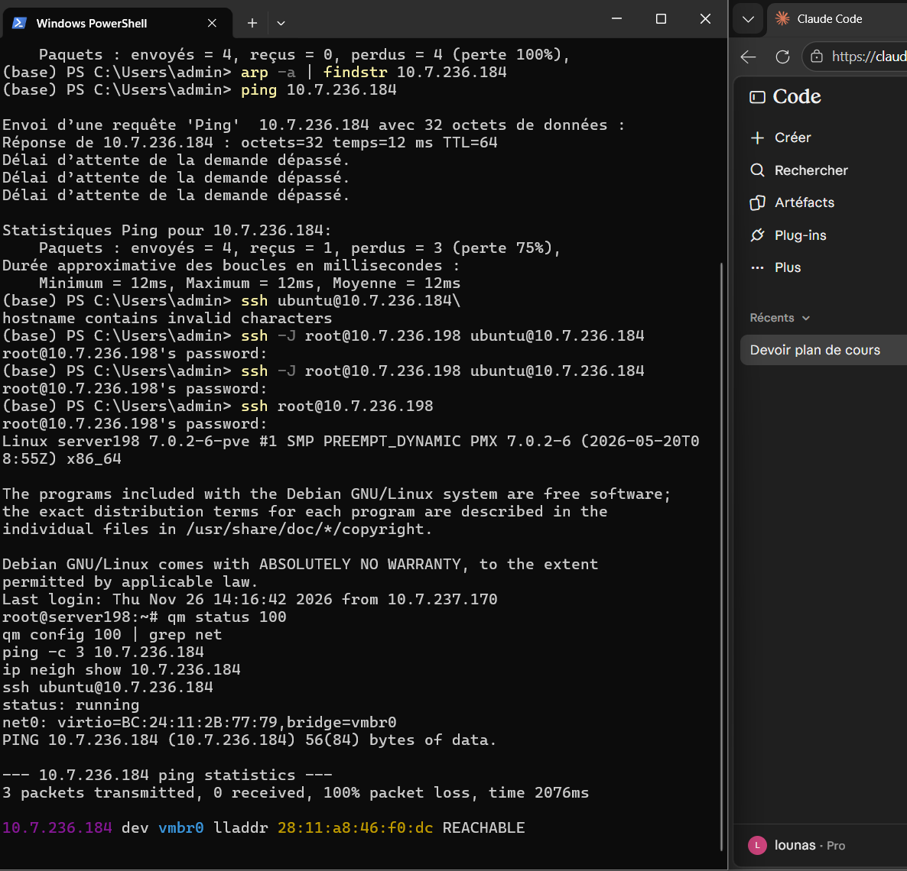
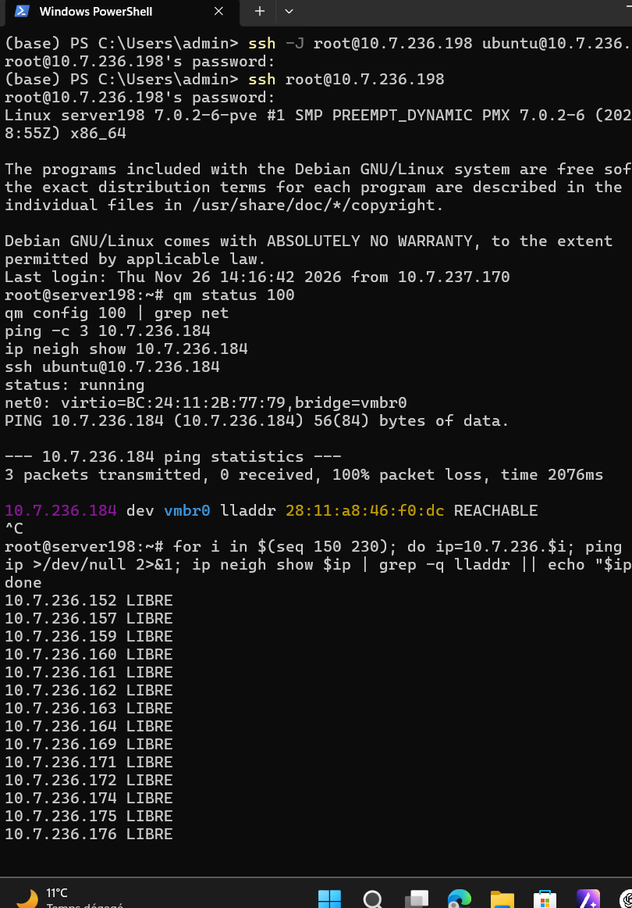
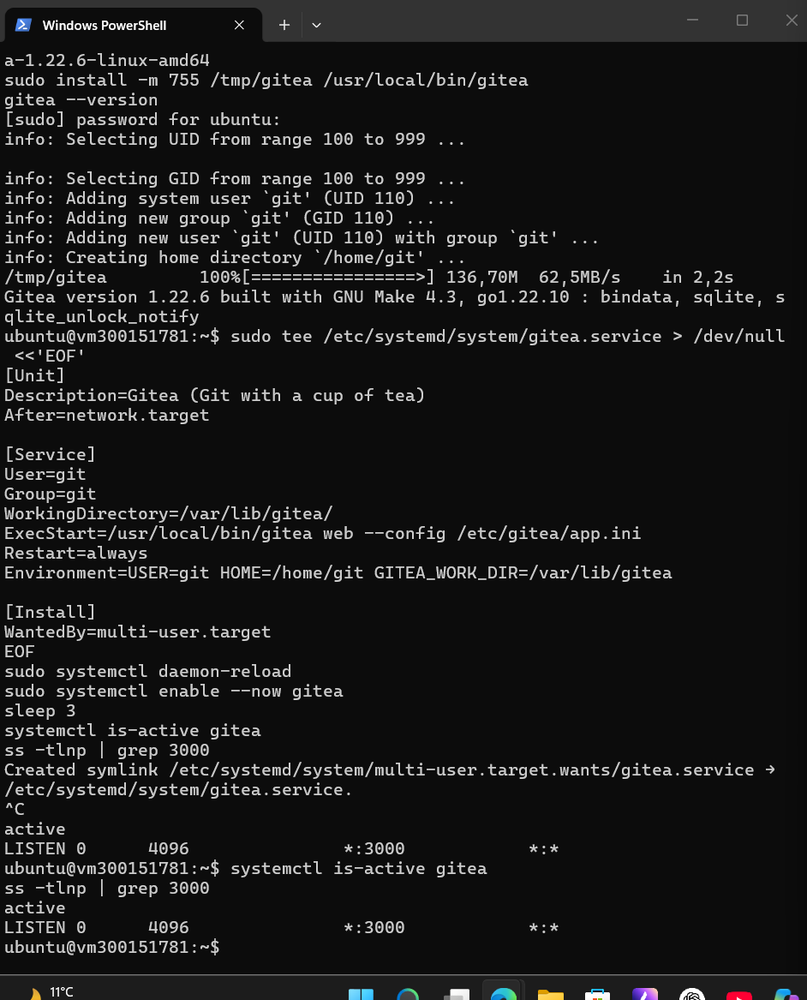
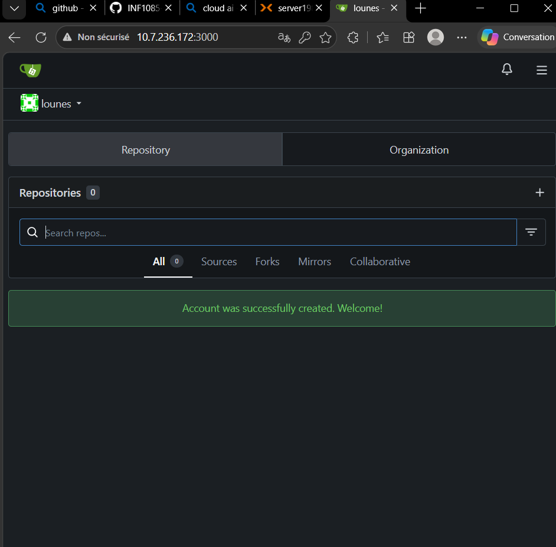
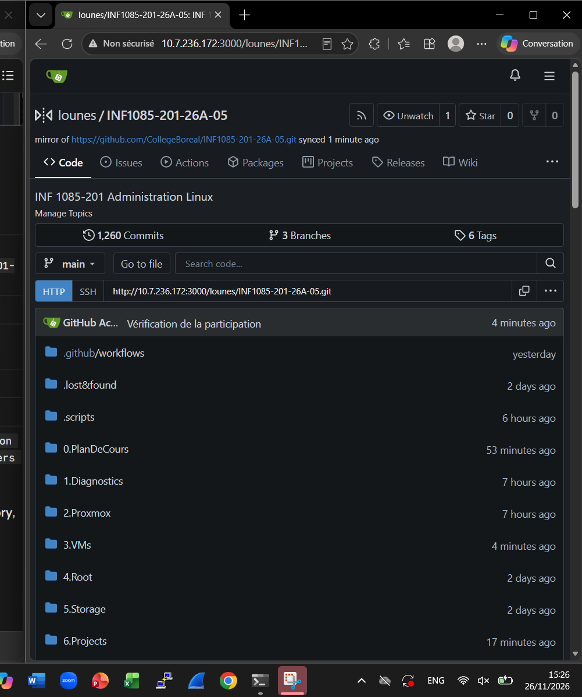
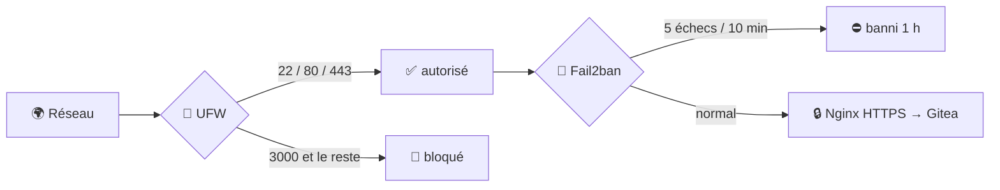
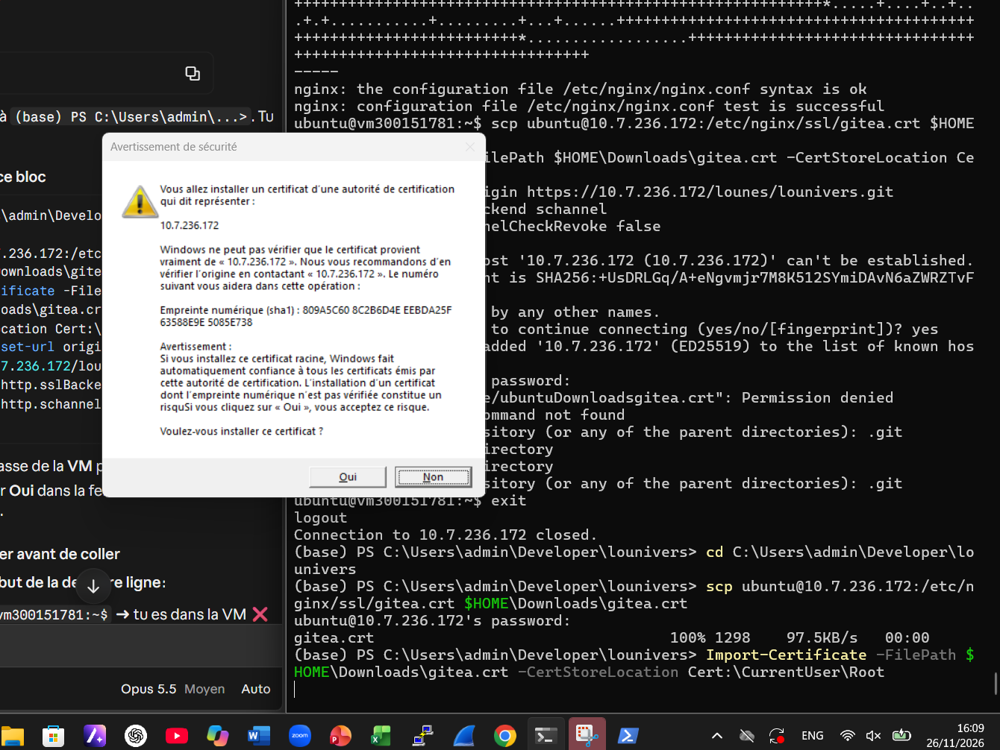

# 🦊 Forge Lounivers : mon propre GitHub sur Proxmox

<p align="center">
  
  
  
  
  
  
  
</p>

> **Étudiant :** Lounes Allouti · **300151781** · INF1085-201 Administration Linux · Collège Boréal
>
> **Projet :** j'ai installé, sécurisé et personnalisé une **forge Git auto-hébergée** (Gitea) sur ma VM Proxmox.
> J'y héberge mon application mobile **Lounivers** (cours INF1083) et un **miroir automatique** de ce cours.
>
> 🌐 **https://10.7.236.172**



---

## 📑 Sommaire

1. [🎯 Pourquoi ce projet](#-pourquoi-ce-projet)
2. [🗺️ Architecture](#️-architecture)
3. [🕵️ L'enquête réseau : 3 IP volées](#️-lenquête-réseau--3-ip-volées)
4. [⚙️ Installation de Gitea](#️-installation-de-gitea)
5. [👑 Configuration et compte admin](#-configuration-et-compte-admin)
6. [🪞 Miroir automatique de GitHub](#-miroir-automatique-de-github)
7. [🚀 Lounivers hébergé sur MA forge](#-lounivers-hébergé-sur-ma-forge)
8. [💾 Sauvegarde automatique](#-sauvegarde-automatique)
9. [🌐 Nginx en reverse proxy](#-nginx-en-reverse-proxy)
10. [🔐 Sécurité : UFW, Fail2ban et HTTPS](#-sécurité--ufw-fail2ban-et-https)
11. [🎨 Personnalisation](#-personnalisation)
12. [✅ Vérifications](#-vérifications)
13. [🧗 Défis rencontrés](#-défis-rencontrés)
14. [🎓 Ce que j'ai appris](#-ce-que-jai-appris)
15. [🔭 Améliorations futures](#-améliorations-futures)

---

## 🎯 Pourquoi ce projet

Sur **GitHub**, mon code est stocké chez Microsoft. Beaucoup d'entreprises préfèrent héberger leur code **chez elles**, pour la confidentialité et le contrôle.

J'ai donc construit **ma propre forge Git**, avec les mêmes réflexes qu'en entreprise :

| Besoin | Ma solution |
|---|---|
| Héberger du code | 🦊 Gitea (dépôts, commits, issues, wiki, Kanban) |
| Démarrer seul, redémarrer après un crash | ⚙️ Service `systemd` |
| Adresse propre, sans port | 🌐 Nginx reverse proxy |
| Chiffrer les échanges | 🔒 HTTPS (TLS 1.2 / 1.3) |
| Bloquer ce qui n'est pas nécessaire | 🧱 Pare-feu UFW |
| Résister aux attaques par mot de passe | 🚨 Fail2ban |
| Ne jamais perdre de données | 💾 Sauvegarde chaque nuit (`cron`) |

> 🔗 **Lien entre mes deux cours :** l'app mobile Lounivers (INF1083) est hébergée sur mon serveur Linux (INF1085).

---

## 🗺️ Architecture



| Élément | Valeur |
|---|---|
| Hyperviseur | Proxmox VE · `server198` · 10.7.236.198 |
| VM | 100 · `vm300151781` · Ubuntu 24.04.3 LTS |
| IP / passerelle | `10.7.236.172/23` · `10.7.237.1` |
| MAC | `BC:24:11:2B:77:79` |
| URL | **https://10.7.236.172** |

> 💡 **Pourquoi dans une VM et pas directement sur Proxmox ?** Proxmox est l'**hyperviseur** : il fait tourner toutes les VM. Installer des logiciels dessus pourrait le casser, et toutes les VM avec. En isolant le service dans une VM, je peux tout casser et recommencer sans toucher au serveur.

---

## 🕵️ L'enquête réseau : 3 IP volées

Avant même d'installer quoi que ce soit, ma VM était **injoignable** (`Connection reset`, puis `Connection timed out`). J'ai mené l'enquête.



| IP | Qui répondait ? | Preuve |
|---|---|---|
| `.172` | Une autre machine (au début) | Conflit dès le lab 3.VMs |
| `.168` | Une autre VM Proxmox, MAC `bc:24:11:39:98:ea` | `arp -a`, alors que **ma VM était éteinte** |
| `.184` | Un vrai PC (carte Intel), MAC `28:11:a8:46:f0:dc` | `ip neigh` sur le serveur Proxmox |
| **`.172`** | ✅ **Ma VM**, MAC `bc:24:11:2b:77:79` | `ip neigh` : 0 % de perte, 0,1 ms |

**Le piège :** mon premier scan depuis Windows (`ping` puis `arp`) avait déclaré `.184` « libre », parce que ce PC **bloquait les pings**.
**La solution :** scanner depuis le serveur Proxmox avec la **table ARP**. Un appareil peut ignorer un ping, mais **pas une requête ARP**.

```bash
for i in $(seq 150 230); do ip=10.7.236.$i; ping -c1 -W1 $ip >/dev/null 2>&1; ip neigh show $ip | grep -q lladdr || echo "$ip LIBRE"; done
```

| ❌ .184 prise par une autre MAC | 🔍 Scan ARP fiable depuis Proxmox |
|---|---|
|  |  |

Changement d'IP depuis la console Proxmox, sans réinstaller :

```bash
sudo sed -i 's/184/172/' /etc/netplan/01-reseau.yaml
sudo netplan apply
```

---

## ⚙️ Installation de Gitea

Gitea est un **seul exécutable** (base SQLite intégrée), donc pas besoin de Docker.

```bash
# Utilisateur système dédié (sans mot de passe, sans connexion)
sudo adduser --system --shell /bin/bash --gecos 'Git Version Control' --group --disabled-password --home /home/git git

# Dossiers de travail + permissions minimales
sudo mkdir -p /var/lib/gitea/{custom,data,log}
sudo chown -R git:git /var/lib/gitea/ && sudo chmod -R 750 /var/lib/gitea/
sudo mkdir -p /etc/gitea && sudo chown root:git /etc/gitea && sudo chmod 770 /etc/gitea

# Binaire officiel
wget -O /tmp/gitea https://dl.gitea.com/gitea/1.22.6/gitea-1.22.6-linux-amd64
sudo install -m 755 /tmp/gitea /usr/local/bin/gitea
```

**Service systemd** `/etc/systemd/system/gitea.service` :

```ini
[Unit]
Description=Gitea (Git with a cup of tea)
After=network.target

[Service]
User=git
Group=git
WorkingDirectory=/var/lib/gitea/
ExecStart=/usr/local/bin/gitea web --config /etc/gitea/app.ini
Restart=always
Environment=USER=git HOME=/home/git GITEA_WORK_DIR=/var/lib/gitea

[Install]
WantedBy=multi-user.target
```

```bash
sudo systemctl daemon-reload
sudo systemctl enable --now gitea
```



> 🛡️ Gitea tourne sous l'utilisateur **`git`**, pas `root` : si le service était compromis, l'attaquant n'aurait pas les droits administrateur.

---

## 👑 Configuration et compte admin

Configuration initiale dans le navigateur : base **SQLite3**, domaine `10.7.236.172`, puis création du compte administrateur **`lounes`** (le premier compte devient admin).



Ensuite, j'ai **fermé les inscriptions** et protégé la configuration :

```bash
sudo sed -i 's/^DISABLE_REGISTRATION *=.*/DISABLE_REGISTRATION = true/' /etc/gitea/app.ini
sudo chmod 750 /etc/gitea
sudo chmod 640 /etc/gitea/app.ini
sudo systemctl restart gitea
```

---

## 🪞 Miroir automatique de GitHub

Gitea copie le dépôt du cours depuis GitHub et le **resynchronise automatiquement** : c'est une sauvegarde de mon travail scolaire sur mon propre serveur.

`＋` → **New Migration** → **GitHub** → `https://github.com/CollegeBoreal/INF1085-201-26A-05` → ✅ *This repository will be a mirror*



> 📊 **1 260 commits**, 3 branches et 6 tags copiés, avec le badge *« mirror of github.com/… synced »*.

---

## 🚀 Lounivers hébergé sur MA forge

Depuis mon PC (PowerShell), j'ai poussé mon app NativeScript/Angular sans les dossiers générés :

```powershell
robocopy ...\7.Projects\300151781\B300151781 C:\Users\admin\Developer\lounivers /E /XD node_modules platforms hooks .ns-build
cd C:\Users\admin\Developer\lounivers
git init -b main
git add .
git commit -m "🚀 Lounivers débarque sur ma forge Gitea"
git remote add origin https://10.7.236.172/lounes/lounivers.git
git push -u origin main
```

```
To http://10.7.236.172:3000/lounes/lounivers.git
 * [new branch]      main -> main
```

> 🔑 Git Credential Manager s'est authentifié auprès de **mon** Gitea en OAuth, exactement comme avec GitHub.

---

## 💾 Sauvegarde automatique

Chaque nuit à **2 h 30**, `cron` lance `gitea dump`, qui produit un `.zip` complet (dépôts, base de données, configuration). Les sauvegardes de plus de 3 jours sont supprimées.

`/etc/cron.d/gitea-backup` :

```cron
30 2 * * * git cd /var/lib/gitea && /usr/local/bin/gitea dump -c /etc/gitea/app.ini -w /var/lib/gitea --file /var/backups/gitea/gitea-$(date +\%F).zip && find /var/backups/gitea -name "*.zip" -mtime +3 -delete
```

Test manuel :

```
Finish dumping in file /var/backups/gitea/gitea-test.zip
-rw------- 1 git git 319M nov. 26 20:25 gitea-test.zip
```

---

## 🌐 Nginx en reverse proxy

Nginx reçoit les visiteurs sur les ports **80/443** et transmet à Gitea, qui n'écoute plus qu'en local (`127.0.0.1:3000`).

`/etc/nginx/sites-available/gitea` :

```nginx
server {
    listen 80;
    server_name 10.7.236.172;
    return 301 https://$host$request_uri;      # HTTP → HTTPS
}

server {
    listen 443 ssl;
    server_name 10.7.236.172;
    ssl_certificate     /etc/nginx/ssl/gitea.crt;
    ssl_certificate_key /etc/nginx/ssl/gitea.key;
    ssl_protocols TLSv1.2 TLSv1.3;
    client_max_body_size 512M;

    location / {
        proxy_pass http://127.0.0.1:3000;
        proxy_set_header Host $host;
        proxy_set_header X-Real-IP $remote_addr;
        proxy_set_header X-Forwarded-For $proxy_add_x_forwarded_for;
        proxy_set_header X-Forwarded-Proto $scheme;
    }
}
```

---

## 🔐 Sécurité : UFW, Fail2ban et HTTPS



### 🧱 Pare-feu UFW

```bash
sudo ufw default deny incoming
sudo ufw default allow outgoing
sudo ufw allow 22/tcp comment 'SSH'
sudo ufw allow 80/tcp comment 'HTTP Nginx'
sudo ufw allow 443/tcp comment 'HTTPS Nginx'
sudo ufw --force enable
```

```
Status: active
Default: deny (incoming), allow (outgoing), disabled (routed)
22/tcp    ALLOW IN    Anywhere    # SSH
80/tcp    ALLOW IN    Anywhere    # HTTP Nginx
443/tcp   ALLOW IN    Anywhere    # HTTPS Nginx
```

> 🧪 **Preuve :** `https://10.7.236.172` ✅ répond, et `http://10.7.236.172:3000` 🚫 ne répond plus.

### 🚨 Fail2ban

`/etc/fail2ban/jail.local` :

```ini
[DEFAULT]
bantime  = 1h
findtime = 10m
maxretry = 5
ignoreip = 127.0.0.1/8 ::1 10.7.236.198

[sshd]
enabled = true
backend = systemd
```

### 🔒 HTTPS

Certificat auto-signé avec l'IP dans le *Subject Alternative Name* (indispensable pour les navigateurs modernes) :

```bash
sudo openssl req -x509 -nodes -days 365 -newkey rsa:2048 \
  -keyout /etc/nginx/ssl/gitea.key -out /etc/nginx/ssl/gitea.crt \
  -subj "/C=CA/ST=Ontario/O=College Boreal/CN=10.7.236.172" \
  -addext "subjectAltName=IP:10.7.236.172"
```

Côté PC, j'ai ajouté le certificat aux autorités de confiance de Windows, pour obtenir le **cadenas** 🔒 dans le navigateur et un `git push` chiffré :

```powershell
scp ubuntu@10.7.236.172:/etc/nginx/ssl/gitea.crt $HOME\Downloads\gitea.crt
Import-Certificate -FilePath $HOME\Downloads\gitea.crt -CertStoreLocation Cert:\CurrentUser\Root
git config http.sslBackend schannel
git config http.schannelCheckRevoke false
```



> ✅ Fini l'avertissement `warning: use of unencrypted HTTP remote URLs` de Git.

---

## 🎨 Personnalisation

Gitea ne ressemble plus à un Gitea « de base » : c'est **Forge Lounivers**.

| Élément | Fichier |
|---|---|
| 🌍 Logo globe + favicon (SVG) | `/var/lib/gitea/custom/public/assets/img/logo.svg` |
| 🏠 Page d'accueil en français (4 atouts du serveur) | `/var/lib/gitea/custom/templates/home.tmpl` |
| 📝 Pied de page à mon nom | `/var/lib/gitea/custom/templates/custom/footer.tmpl` |
| 🌑 Thème sombre, 🇫🇷 français, nom du site | `/etc/gitea/app.ini` (`[ui]`, `[i18n]`, `APP_NAME`) |

```ini
APP_NAME = Forge Lounivers

[ui]
DEFAULT_THEME = gitea-dark

[i18n]
LANGS = fr-FR,en-US
NAMES = Français,English
```

---

## ✅ Vérifications

```bash
systemctl is-active gitea nginx fail2ban ssh   # active ×4
sudo ufw status                                # Status: active
sudo nginx -t                                  # syntax is ok
sudo fail2ban-client status sshd               # Currently banned: 0
ls -lh /var/backups/gitea                      # gitea-*.zip
curl -skI https://localhost | head -1          # HTTP/1.1 200 OK
```

> 💪 **Résilience prouvée :** la VM a crashé pendant le projet (serveur Proxmox surchargé, messages `rcu stall`). Après le redémarrage, **Gitea, Nginx, UFW et Fail2ban sont repartis seuls**, sans aucune intervention.

---

## 🧗 Défis rencontrés

| # | Problème | Diagnostic | Solution |
|---|---|---|---|
| 1 | `Connection reset` sur .168 | `arp -a` : une **autre MAC** répond | Changer d'IP |
| 2 | .184 « libre » mais injoignable | Le PC qui l'occupait **bloquait les pings** | Scan **ARP** depuis Proxmox → retour sur .172 |
| 3 | VM figée, messages `rcu stall` | Serveur Proxmox **surchargé** | `qm stop 100` / `qm start 100` depuis le serveur |
| 4 | Un long bloc collé par SSH s'est mélangé | Le terminal a été saturé | Coller en **petits blocs** puis vérifier (`tail`, `wc -l`) |
| 5 | Section `[i18n]` en double dans `app.ini` | `grep -c '^\[i18n\]'` → 2 | `sed` pour nettoyer, puis réécriture unique |
| 6 | `502 Bad Gateway` | Gitea redémarrait pendant le test | Attendre 5 s : Nginx est OK |
| 7 | Session SSH coupée en installant Fail2ban | `uptime` → `up 0 min` : la VM avait redémarré | `fail2ban-client set sshd unbanip` pour vérifier, puis liste blanche |
| 8 | Git refusait le certificat auto-signé | Certificat inconnu de Windows | `Import-Certificate` + `schannel` |

---

## 🎓 Ce que j'ai appris

- 🌐 **Une IP statique n'est réservée nulle part.** On vérifie toujours avec **ARP**, pas seulement avec `ping`.
- 🖥️ **Proxmox** permet de dépanner une VM même sans réseau : console noVNC, `qm stop` / `qm start`.
- ⚙️ **systemd** rend un service **autonome** : il démarre au boot et redémarre après un crash.
- 🌐 Un **reverse proxy** sépare l'application de l'exposition réseau : Gitea n'écoute qu'en local.
- 🔐 La **défense en profondeur** : UFW, puis Fail2ban, puis HTTPS, puis inscriptions fermées, puis `chmod 640`.
- 💾 Une sauvegarde **automatique et testée** vaut mieux que dix sauvegardes manuelles oubliées.
- 🧑‍💻 Toujours savoir **où** on tape une commande : PowerShell (PC) ≠ SSH (VM) ≠ navigateur.

---

## 🔭 Améliorations futures

- [ ] 🤖 **CI/CD Gitea Actions** : tester Lounivers automatiquement à chaque `push`
- [ ] 🔑 **Git par SSH** (port 22) avec ma clé ed25519
- [ ] 🛡️ Fail2ban aussi sur la page de connexion Gitea
- [ ] 📤 Copier les sauvegardes **hors de la VM** (sur le stockage Proxmox)
- [ ] 📌 Demander au prof de **réserver** l'IP `.172` à mon nom

---

<p align="center">
  🌍 <b>Forge Lounivers</b> · Lounes Allouti · 300151781 · INF1085 · Collège Boréal<br>
  <i>« Mon code, mon serveur, mes règles. »</i>
</p>
