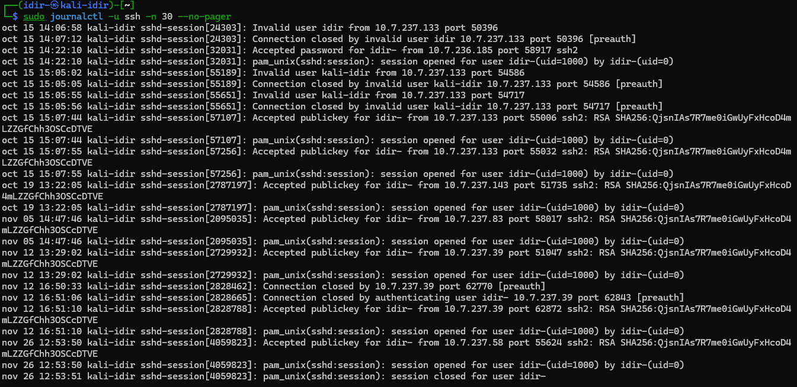
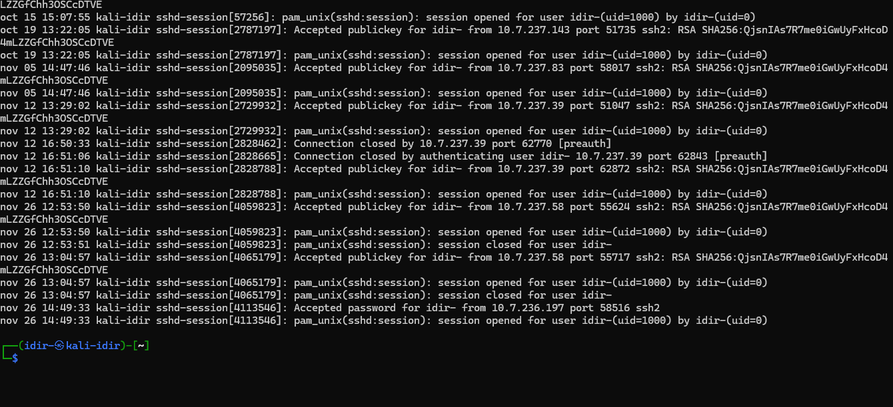
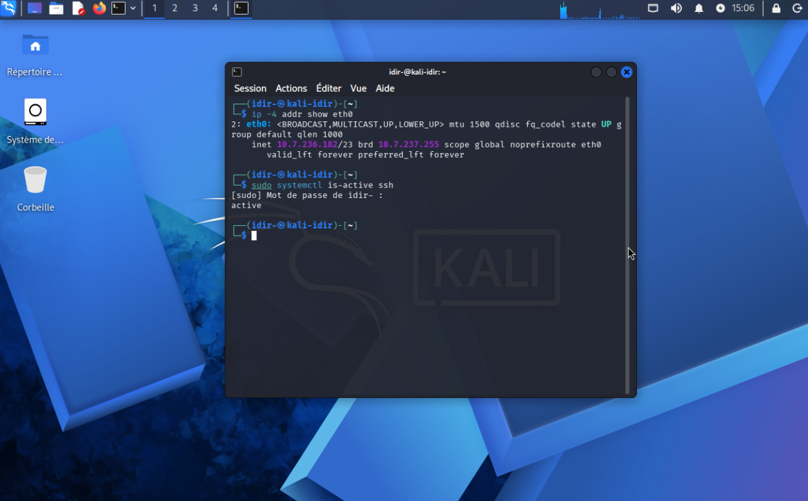
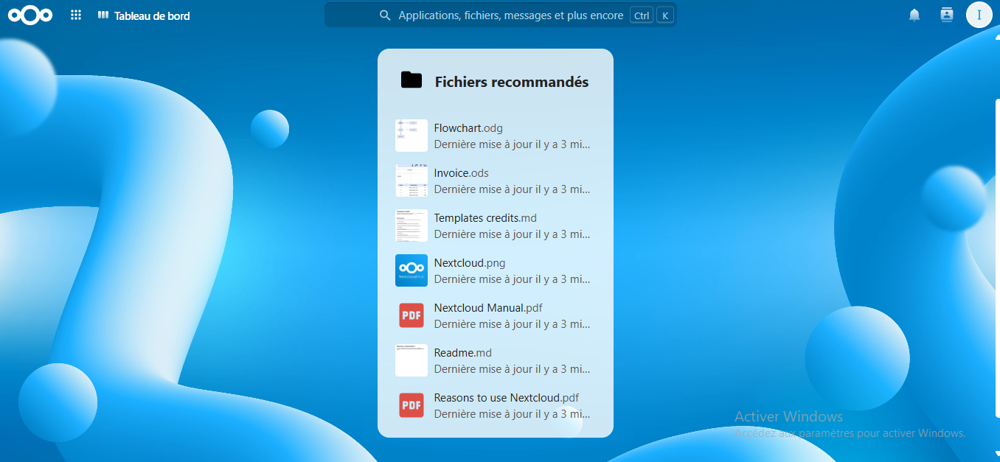
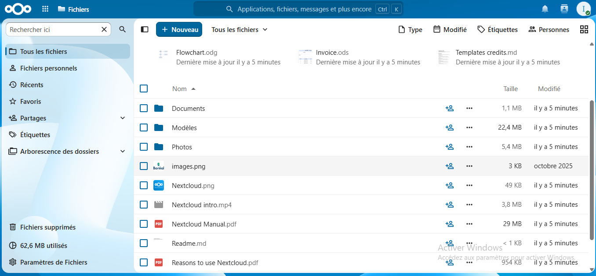

# ☁️ Projet Nextcloud — INF1085 Administration Linux

> Projet du cours **INF1085 — Administration Linux**
> Collège Boréal, session automne 2026.
> Étudiant : **Idir Islam Chili**
> 🆔 300156187

## 1. 📋 Présentation du projet

J'ai choisi d'installer Nextcloud sur ma machine virtuelle. Nextcloud est un
cloud auto-hébergé, comme Google Drive, mais installé sur mon propre serveur.
Il permet de stocker des fichiers, de les partager et d'y accéder depuis un
navigateur.

## 2. 🖥️ Ma machine virtuelle

- VM 103 (`kali-idir`) sur Proxmox (server46)
- Système : Kali Linux 2026.2
- Adresse IP : 10.7.236.182 (statique)
- Utilisateur : `idir-`

## 3. ⚙️ Installation

### 3.1 Apache et MariaDB

```bash
sudo apt update
sudo apt install -y apache2 mariadb-server
sudo systemctl enable --now mariadb
```

### 3.2 PHP

```bash
sudo apt install -y php libapache2-mod-php php-mysql php-gd php-curl php-zip php-xml php-mbstring php-intl php-bcmath php-gmp php-imagick php-apcu unzip
```

### 3.3 Téléchargement et installation de Nextcloud

```bash
cd /tmp && wget https://download.nextcloud.com/server/releases/latest.zip
sudo unzip -q latest.zip -d /var/www/
sudo chown -R www-data:www-data /var/www/nextcloud
```

### 3.4 Base de données

```bash
sudo mysql -e "CREATE DATABASE nextcloud CHARACTER SET utf8mb4 COLLATE utf8mb4_general_ci;"
sudo mysql -e "CREATE USER 'nextcloud'@'localhost' IDENTIFIED BY 'MOT_DE_PASSE'; GRANT ALL PRIVILEGES ON nextcloud.* TO 'nextcloud'@'localhost'; FLUSH PRIVILEGES;"
```

(Le mot de passe n'est pas écrit dans ce document.)

### 3.5 Configuration d'Apache

```bash
sudo a2enmod rewrite headers env dir mime
sudo sed -i 's|/var/www/html|/var/www/nextcloud|' /etc/apache2/sites-enabled/000-default.conf
sudo systemctl restart apache2
```

### 3.6 Assistant d'installation web

J'ai ouvert http://10.7.236.182 dans le navigateur, créé le compte
administrateur `idir-`, puis renseigné la base de données (utilisateur
`nextcloud`, base `nextcloud`, hôte `localhost`).
Version installée : Nextcloud 35.0.3.

## 4. 🌐 Problème d'Internet et solution

L'adresse statique 10.7.236.182 n'a pas accès à Internet (ping 100% loss,
l'adresse est filtrée par le réseau du collège). J'ai testé avec une adresse
DHCP (10.7.236.207) : elle a Internet. J'ai donc ajouté la .207
manuellement et changé la route par défaut pour utiliser la .207 comme
source, ce qui m'a permis de télécharger les paquets et Nextcloud. Une fois
l'installation terminée, j'ai retiré la .207, remis la route sur la .182 et
remis le profil réseau en statique. La VM est revenue à son état d'origine
(IP .182 seule).

## 5. 🔑 Vérification de l'accès SSH (26 novembre 2026)

La clé SSH du professeur (`b300098957@ramena`) est installée dans
`~/.ssh/authorized_keys` (2 fois). Les permissions sont correctes
(.ssh 700, authorized_keys 600). D'après le journal SSH
(`sudo journalctl -u ssh`), la clé du professeur a été acceptée le
26 novembre à 12:53 et 13:04 (depuis 10.7.237.58), ainsi que le
12 novembre, le 5 novembre, le 19 et le 15 octobre. La tentative bloquée
du professeur (Ctrl+C) n'apparaît pas dans le journal : elle n'est jamais
arrivée jusqu'à la VM, donc le problème venait du réseau côté professeur.
Le 15 octobre, le professeur avait essayé les mauvais noms `idir` et
`kali-idir` avant de réussir avec `idir-`.





## 6. ✅ Vérification du fonctionnement

J'ai ouvert Nextcloud dans le navigateur (http://10.7.236.182) et je me
suis connecté avec le compte administrateur. J'ai envoyé un fichier de
test (`images.png`, 3 Ko) : il apparaît bien dans Fichiers.




© 2026 Idir Islam Chili — Tous droits réservés
